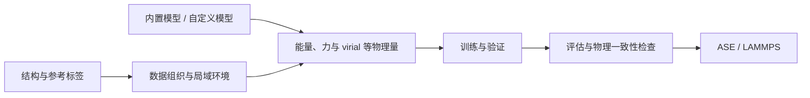

# ABFML

**面向问题导向开发的机器学习力场研究框架。**

ABFML 基于 PyTorch，帮助研究者围绕具体物理问题构建、筛选和验证机器学习力场（MLFF）。
框架通过统一的原子结构、局域环境和物理量接口，将自定义模型接入数据处理、训练评估与原子模拟流程。
用户可以从内置模型开始，也可以实现自己的描述符、网络结构和物理属性预测模型。

**自定义模型也能直接用于 LAMMPS：任意满足 ABFML 接口契约的模型，均可通过统一的 `pair_style abfml` 加载运行，无需为每个模型单独编写 C++ Pair 类，也无需导出 TorchScript 或链接 LibTorch。**

当前 LAMMPS 接口要求模型使用 `local` 几何和 `external` 近邻，并正确处理本地中心、local/ghost 原子及所请求的物理量。详见 [LAMMPS 接口](lmp/ABFML/README.md)。

项目相关论文：[ABFML: A problem-oriented package for rapidly creating, screening, and optimizing new machine learning force fields](https://doi.org/10.1063/5.0247559)。

## 框架特点

- **支持自定义模型**：通过模型类、配置解析和显式注册接入扩展模块，复用训练、评估及适用的模拟接口。
- **统一接入 LAMMPS**：内置模型与满足接口契约的自定义模型使用同一个 Python 桥接和 Pair 样式，模型开发后可继续用于分子动力学模拟。
- **统一数据组织**：变长原子体系采用展平存储和 CSR 邻居图，按模型需要生成 Dense 视图。
- **统一物理量契约**：集中定义标签的作用域、形状、单位和归一化方式；可微能量模型复用力与 virial 求导。
- **完整训练与验证**：支持断点续训、微调、最佳模型选择，以及导数和对称性检查。
- **自动分析结果**：训练结束生成损失与预测组图，打印最佳模型误差汇总和阶段耗时。
- **连接 ASE**：提供统一 Calculator，衔接单点计算、结构优化和原子模拟流程。



## 安装

要求 Python 3.11 或更新版本，依赖 PyTorch、NumPy、ASE 和 Matplotlib。
使用仓库当前代码时，在项目根目录执行：

```bash
python -m pip install -e .
abfml --help
```

`-e` 适合开发与调试；普通源码安装可使用 `python -m pip install .`。
也可安装 PyPI 发行版：

```bash
python -m pip install abfml
```

CPU 可运行示例；使用 GPU 时，请在对应环境中安装适配硬件的 PyTorch。
`python -m abfml` 与 `abfml` 使用同一命令行入口。以下命令均以**项目根目录**为工作目录。

## 快速开始

使用附带的 Cu 数据运行 ACSF 示例：

```bash
abfml train examples/acsf/input.json --epochs 1
```

该配置输出到 `examples/acsf/results/`，包含标准模型 `model.pt`、训练 checkpoint、
损失组图 `loss.png` 和满足绘图条件时的预测组图 `parity.png`。
训练结束会打印最佳模型的误差汇总，以及数据与初始化、训练与验证、最终评估、结果输出四项耗时。
示例用于验证流程，完整产物说明见[训练工作流](docs/workflows.md)。

```bash
# 断点续训：恢复训练状态，再增加 10 轮
abfml train examples/acsf/input.json --resume examples/acsf/results/last.pt --epochs 10

# 微调：读取模型权重，重新初始化优化器
abfml train examples/acsf/input.json --fine-tune examples/acsf/results/best.pt --epochs 10

# 独立评估
abfml evaluate examples/acsf/results/best.pt examples/data/test.extxyz --output evaluation

# 导数与对称性检查
abfml check examples/acsf/results/best.pt examples/data/test.extxyz

# 标签分布分析
abfml plot labels examples/data/test.extxyz
```

JSON 中的数据与输出路径相对**配置文件所在目录**解析，命令行文件参数相对当前工作目录解析。
`--epochs` 表示本次新增的轮数，`--resume` 与 `--fine-tune` 互斥。
`abfml check model.pt` 默认按模型元素自动生成测试结构，无需训练数据或参考标签；也可显式提供结构文件检查实际构型。检查使用双精度，打印逐项结果及耗时。
示例中的评估复用了演示数据，实际泛化能力应使用独立测试集验证。

## 内置模型与扩展示例

| 模型 | `model.name` | 实现方式 | 示例 |
|---|---|---|---|
| ACSF | `acsf` | 原子中心对称函数与神经网络 | [acsf](examples/acsf/input.json) |
| DeepPot-SE e2_a | `deep_pot_se_e2_a` | 二体全坐标描述符 | [deepse2a](examples/deepse2a/input.json) |
| DeepPot-SE e2_r | `deep_pot_se_e2_r` | 二体径向描述符 | [deepse2r](examples/deepse2r/input.json) |
| DeepPot-SE e3 | `deep_pot_se_e3` | 三体描述符 | [deepse3](examples/deepse3/input.json) |
| NEP | `nep` | 径向、角向描述符与拟合网络 | [nep](examples/nep/input.json) |
| Lennard-Jones | `lennard_jones` | 解析双体势 | [lj](examples/lj/input.json) |
| 谐振对势 | `harmonic_pair` | 自定义模型的最小示例 | [harmonic.py](examples/harmonic/harmonic.py) |

内置模型用于提供可运行的起点和比较基线。模型公式与数值约定见[模型理论](docs/theory.md)，
扩展接口见[新增模型与自注册](docs/model-extension.md)。

## 自定义模型

一个扩展模块通常包含模型类、配置解析类和注册语句。
模型继承 `AtomicModel`，通过 `compute()` 接收 `ModelInput` 并返回 `ModelOutput`。
例如，谐振对势的核心计算为：

```python
class HarmonicPair(AtomicModel):
    def compute(self, inputs: ModelInput) -> ModelOutput:
        _, ptr, _, vectors = inputs.require_neighbors()
        distances = torch.linalg.vector_norm(vectors, dim=-1)
        edges = .25 * self.stiffness * (distances - self.equilibrium).square()
        atomic = segment_sum(edges, ptr)
        return ModelOutput(energy=atomic.sum(), atomic_energies=atomic)

register_model("harmonic_pair", ModelSpec(HarmonicPair, HarmonicPairConfig))
```

初始化、导入与配置类见[完整示例](examples/harmonic/harmonic.py)。
该模型用于说明接入方式，截断处未平滑。
在完整训练配置中加入模块名，并替换 `model` 段，其余配置保持正常填写：

```json
{
  "model_modules": ["examples.harmonic.harmonic"],
  "model": {
    "name": "harmonic_pair",
    "cutoff": 3.0,
    "stiffness": 0.2,
    "equilibrium": 1.0
  }
}
```

从项目根目录运行 `python -m abfml train input.json` 即可加载该示例。
`model_modules` 遵循 Python 导入规则，并额外搜索配置文件所在目录。
实际项目也可使用已安装的扩展包，例如 `my_package.my_model`。

模型可声明使用外部邻居、自行建邻居或不使用邻居。
可微能量模型可复用框架的力与 virial 计算；直接预测力的模型需声明相应计算方式。
额外物理量通过 `ModelOutput.properties` 和[统一标签说明](docs/labels.md)接入。
对满足接口契约的模型，可以复用训练、保存、重载和评估流程；ASE 与 LAMMPS 另有各自的属性及几何要求。

## 结果分析

独立评估默认保存 `predictions.extxyz` 和一张 `parity.png`，并给出 MAE、RMSE 与相对误差。
`ref_*` 和 `pred_*` 分别保存参考值与预测值。无参考标签时只输出预测。

分析工具不依赖 input.json，默认在当前目录生成一张 PNG 组图，并打印主要统计：

```bash
# 邻居数分布及最小值、最大值、均值等统计
abfml plot neighbors examples/data/test.extxyz --cutoff 4 5 6

# 原子环境描述符分析；--level structure 切换为结构平均描述符
abfml plot descriptors --model examples/acsf/results/best.pt --dataset test=examples/data/test.extxyz --level atom

# 显式导出参考值、预测值两列，供用户自行绘图
abfml plot pairs evaluation/predictions.extxyz --label forces --output forces.csv
```

标签、邻居和描述符分析加 `--output` 才额外导出数值文件；`--output DIR` 同时指定保存目录。
`pairs` 是显式导出操作，其 `--output` 指定 CSV 文件名。
更多参数和 Python 调用方式见[分析工具](abfml/tools/README.md)。

## ASE 与 LAMMPS

```python
from ase.io import read
from abfml.interfaces import ABFMLCalculator

atoms = read("examples/data/test.extxyz", index=0)
atoms.calc = ABFMLCalculator("examples/acsf/results/best.pt", device="cpu")
energy = atoms.get_potential_energy()
forces = atoms.get_forces()
```

ASE Calculator 可用于单点计算，并与 ASE 优化和模拟流程衔接。

LAMMPS 插件需单独编译，在读取或创建原子后设置：

```lammps
# 输入文件前面需设置 units metal、atom_style atomic 和 newton on
plugin load /absolute/path/ABFML/lmp/ABFML/build/libabfml.so
pair_style abfml examples/acsf/results/best.pt cpu
pair_coeff * * Cu
run 0
```

同一插件也可加载自定义模型。例如，训练 `examples/harmonic/input.json` 后，将模型参数替换为 `examples/harmonic/results/model.pt` 即可。运行环境中需能导入对应的模型扩展模块。

`pair_style abfml MODEL [DEVICE]` 指定模型路径及设备，默认 `cpu`、`eager`、`float32`。
需要双精度或编译加速时，可写为 `pair_style abfml MODEL cpu mode compile precision float64`。
`pair_coeff` 按原子类型顺序指定元素符号，如 `Cu O`；模型路径相对运行目录解析。
运行时需使用安装了 ABFML 的 Python 环境，模型须支持 `local` 几何与 `external` 邻居。
编译命令、完整输入及并行运行方式见 [LAMMPS 接口](lmp/ABFML/README.md)；
内部单位、应力和 virial 约定见[标签说明](docs/labels.md)。

## 项目结构与文档

版本变化和迁移注意事项见[更新说明](CHANGELOG.md)。

完整操作流程见[用户手册](docs/manual.md)，涵盖安装、数据准备、训练评估、自定义模型及 ASE/LAMMPS 使用。

文档网站支持本地预览，在项目根目录执行：

```bash
python -m pip install -r requirements-docs.txt
python -m mkdocs serve
```

随后打开 `http://127.0.0.1:8000/ABFML/`。静态构建使用 `python -m mkdocs build --strict`；
GitHub Pages 发布设置见[本地预览与发布](docs/publishing.md)。

| 目录 | 职责 |
|---|---|
| `abfml/core/` | 原子结构、模型契约、标签说明、邻居图与模型注册 |
| `abfml/data/` | 结构读取、数据集与批次组装 |
| `abfml/builtin/` | 内置模型、网络层与数学函数 |
| `abfml/training/` | 损失、优化器、训练循环与 checkpoint |
| `abfml/workflows/` | 训练、评估与物理检查流程 |
| `abfml/interfaces/` | ASE 与 LAMMPS 的 Python 接口 |
| `abfml/tools/` | 标签、邻居、描述符与误差分析 |
| `lmp/ABFML/` | LAMMPS C++ 插件 |
| `examples/`、`tests/`、`docs/` | 示例、测试与详细文档 |

- [架构与数据流](docs/architecture.md) · [模型理论](docs/theory.md)
- [数据与标签](docs/labels.md) · [训练工作流](docs/workflows.md)
- [ASE 与物理检查](docs/ase-and-checks.md) · [新增模型](docs/model-extension.md)
- [分析工具](abfml/tools/README.md) · [模型示例](examples/README.md)

## 引用

如果 ABFML 对您的研究有帮助，请引用：

```bibtex
@article{geng2025abfml,
  author  = {Geng, Xingze and Gu, Jianing and Qin, Gaowu and Wang, Lin-Wang and Meng, Xiangying},
  title   = {ABFML: A problem-oriented package for rapidly creating, screening, and optimizing new machine learning force fields},
  journal = {The Journal of Chemical Physics},
  volume  = {162},
  number  = {5},
  pages   = {052502},
  year    = {2025},
  doi     = {10.1063/5.0247559}
}
```

## 许可证

[GPL-3.0-only](LICENSE)。
