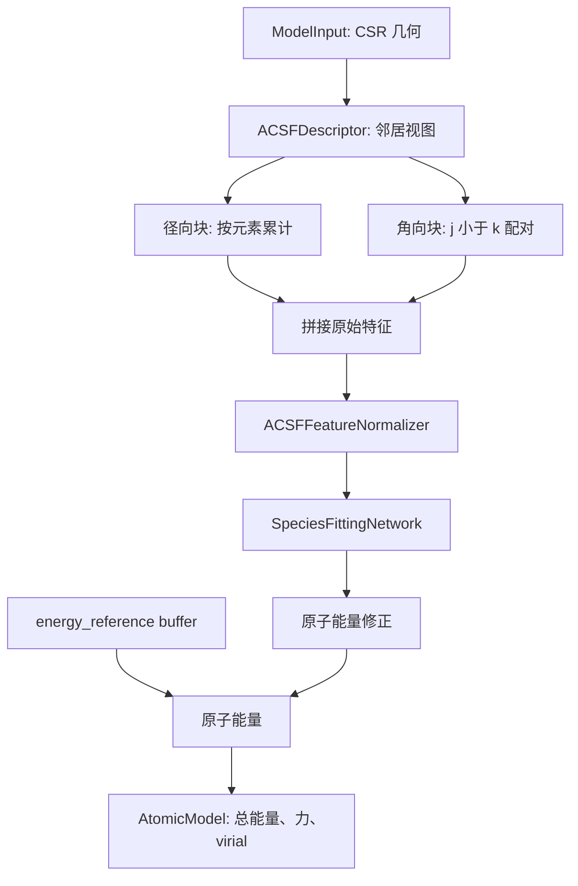
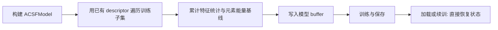

# ACSF 配置、公式与模型结构

ACSF（Atom-Centered Symmetry Functions，原子中心对称函数）模型采用
Behler–Parrinello 类型的原子能量网络，保留高斯径向、窄角向和宽角向三种指数型描述子。
Python 类为 `ACSFModel`，配置类为 `ACSFConfig`，注册名和配置中的模型名为 `acsf`。

## 配置

以下是完整的 `model` 配置段，可替换训练配置中的同名部分：

```json
{
  "name": "acsf",
  "descriptor": {
    "cutoff": 6.0,
    "cutoff_function": "cos",
    "max_neighbors": 100,
    "blocks": [
      {
        "type": "radial_gaussian",
        "basis": [
          {"eta": 1.0, "rs": 0.0},
          {"eta": 1.0, "rs": 1.5}
        ]
      },
      {
        "type": "angular_narrow",
        "basis": [
          {"eta": 0.1, "rs": 0.0, "lambda": 1, "zeta": 2}
        ]
      },
      {
        "type": "angular_wide",
        "basis": [
          {"eta": 0.1, "rs": 0.0, "lambda": -1, "zeta": 1}
        ]
      }
    ]
  },
  "fitting": {
    "hidden_layers": [64, 64],
    "activation": "tanh",
    "bias": true,
    "residual": false
  }
}
```

每条 basis 是一组完整参数，不做笛卡尔积展开，不再接受 `num_basis` 或平行参数数组。
每个块至少包含一条基函数，块的排列顺序决定特征拼接顺序。允许只选择其中部分描述子。

| 参数 | 约定 |
|---|---|
| `cutoff` | 正有限数，单位 Å；全部块共用 |
| `cutoff_function` | 当前只支持 `cos`，省略时为 `cos` |
| `max_neighbors` | 正整数，省略时为 100；稠密邻居容量，溢出报错，不静默截断 |
| `eta` | 正有限数，单位 Å⁻² |
| `rs` | 非负有限数，单位 Å |
| `lambda` | 角向专用，取 -1 或 +1 |
| `zeta` | 角向专用，取正整数，避免非整数幂在共线角度处的二阶导数奇异 |
| `hidden_layers` | 拟合网络隐藏层宽度；输入维度由描述子自动计算，输出为标量 |

`r_min` 不属于这里的余弦 ACSF 截断定义。`SymFunRad/AngN/AngW`、
`acsf_features_information`、`acsf_features_param` 和 `ACSFMlp` 已移除。
旧 ACSF 模型文件的通道排列和状态结构不同，需要使用新配置重新训练。

## 三种公式

定义中心 i 到邻居 j 的相对矢量为 r_ij（含周期平移），距离为其模长。
余弦截断为：

\[
f_c(r)=\begin{cases}
\frac12[\cos(\pi r/r_c)+1],&0\le r<r_c,\\
0,&r\ge r_c.
\end{cases}
\]

定义每条基函数的径向项和角度项：

\[
p(r)=\exp[-\eta(r-R_s)^2]f_c(r),\qquad
A(\theta)=2^{1-\zeta}(1+\lambda\cos\theta)^\zeta.
\]

径向按邻居元素 a 分组：

\[
G_i^{\mathrm{rad},a}=\sum_{j\in\mathcal N_i,\ s_j=a}p(r_{ij}).
\]

宽角向按无序元素对 {a,b} 分组：

\[
G_i^{\mathrm{wide},ab}
=\sum_{\substack{j,k\in\mathcal N_i,\ j<k\\\{s_j,s_k\}=\{a,b\}}}
A(\theta_{ijk})p(r_{ij})p(r_{ik}).
\]

窄角向额外包含邻居间距离：

\[
G_i^{\mathrm{narrow},ab}
=\sum_{\substack{j,k\in\mathcal N_i,\ j<k\\\{s_j,s_k\}=\{a,b\}}}
A(\theta_{ijk})p(r_{ij})p(r_{ik})p(r_{jk}).
\]

这些分别对应 n2p2 的 type 2、9、3；这里采用其支持径向平移的公式形式。
参考 [n2p2 对称函数定义](https://compphysvienna.github.io/n2p2/api/symmetry_function_types.html)。

配对条件 j<k 使用邻居槽位；同一原子的不同周期像可以形成有效邻居对。
只有一个有效邻居时，两种角向描述子都为零。窄角向的 r_jk 由两个已选周期像的
相对矢量之差计算，不对这条差矢量再次做最小镜像折叠。

## 模型结构与状态



基函数参数和归一化统计是 buffer，拟合网络是可训练参数；元素能量基线作为
独立的 `energy_reference` buffer，网络预测其修正：

\[
E_i=E^{\mathrm{ref}}_{s_i}+\mathrm{NN}_{s_i}(\widetilde{\mathbf G}_i),\qquad E=\sum_i E_i.
\]

归一化采用每个中心元素、每个特征列的均值与样本标准差。标准差大于 1e-8 时
执行减均值再除标准差；其余通道仅减均值。它们仍可在新结构上产生非零响应，
不会被永久屏蔽。校准需要每种中心元素至少两个原子样本和结构能量标签。



校准不创建临时拟合网络、不消耗 PyTorch 随机数、不使用验证集。
续训与微调沿用保存的统计量和能量基线。推理不需要训练数据。

## 特征顺序与 Python 使用

按配置中的 blocks 顺序拼接；每个块内部先按元素通道，再按 basis 顺序排列。
若元素顺序为 [H,O]，径向通道为 H、O，角向通道为 H-H、H-O、O-O。

令 T 为元素数，K_r、K_n、K_w 为各类基函数总数，则：

\[
D=T K_r+\frac{T(T+1)}2(K_n+K_w).
\]

`descriptor.output_dim` 给出 D；`descriptor.feature_layout` 逐列记录块编号、
类型、元素、基函数编号和参数，可用来解释归一化统计及拟合网络的输入。

```python
import json
import torch
import abfml.builtin
from abfml.core.registry import build_model, parse_options
from abfml.data import ASEReader, AtomicDataset, create_dataloader
from abfml.core.neighbor import resolve_builder

# 建议在构造前选定目标精度，避免先按 float32 初始化再升精度。
torch.set_default_dtype(torch.float64)
raw = json.load(open("input.json", encoding="utf-8"))
config = parse_options(raw["model"], type_map=(29,))
model = build_model("acsf", **config.model_kwargs())
training_set = AtomicDataset(ASEReader("train.extxyz"))
provider = resolve_builder(model)
model.initialize_statistics(training_set, provider)
for inputs, labels in create_dataloader(training_set, provider, batch_size=2):
    output = model(inputs)
```

完整 Cu 配置见 [acsf/input.json](../examples/acsf/input.json)：

```bash
abfml train examples/acsf/input.json --epochs 1
```

输出路径相对配置文件所在目录解析。该配置用于展示三种描述子，并非优化后的超参数。
