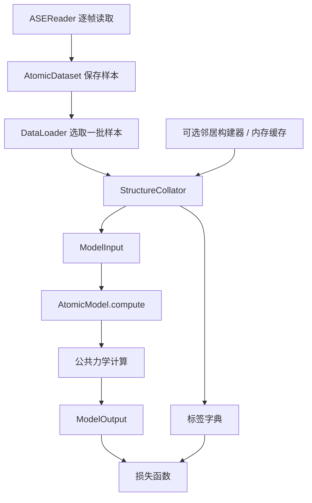
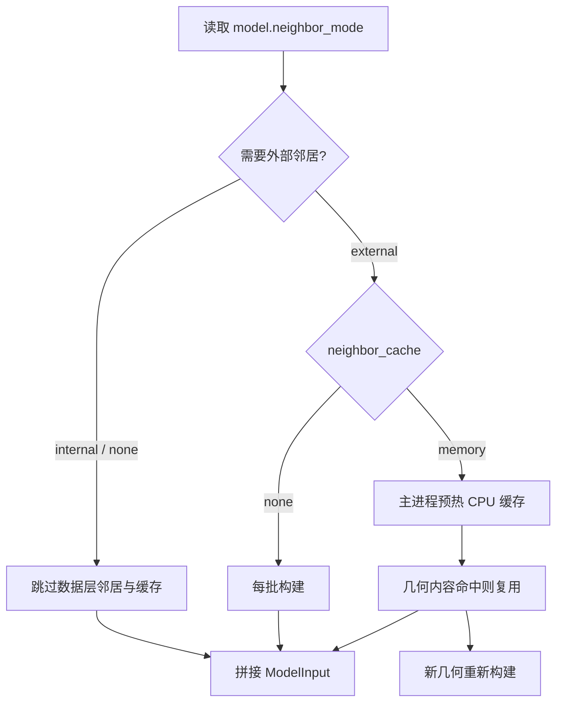

# 架构与数据流

## 文件组织

源码最多保留一层子目录，模型家族各占一个完整文件。同一职责内紧密配合的
函数和类放在一起；仅在有明确复用或依赖边界时拆分文件。

```text
abfml/
  __init__.py  __main__.py  cli.py  logger.py
  config.py  serialization.py
  core/
    structure.py  types.py  schema.py  model.py  neighbor.py  registry.py
  data/
    reader.py  dataset.py  collate.py  loader.py
  builtin/
    acsf.py  deepse.py  nep.py  lennard_jones.py
    networks.py  functions.py  statistics.py
  training/
    trainer.py  loss.py  optimizer.py  checkpoint.py
  workflows/
    train.py  evaluate.py  check.py
  interfaces/
    ase.py
tests/         单元测试、工作流测试与性能测量脚本
examples/      示例脚本、配置及 data/ 数据
docs/          使用说明、架构和公式
runs/          运行产物；archive/ 保留迁移前的示例实验记录
```

`core` 定义张量数据、模型契约、邻居处理及注册机制；导入时不加载 ASE 或任何具体模型。
`core/schema.py` 统一定义标签作用域、分量形状、内部/显示单位和归一化规则，
供样本、collate、损失、评估、日志和 tools 复用，详见[物理标签说明](labels.md)。
ASE 与 `AtomicSample` 的转换使用 `data/reader.py` 的 `from_ase`、`to_ase`；
邻居图、CSR/Dense 转换、`ASENeighborBuilder`、后端选择和内存缓存统一位于
`core/neighbor.py`。ASE 后端仅在实际 `build()` 时导入 ASE，不反向依赖数据层；
`data/reader.py` 仅承担结构读取、标签读取与 ASE 转换。
`builtin` 中的配置、描述子、模型和注册语句同处一个模型文件；网络和统计工具供模型复用。
`training/trainer.py` 包含训练循环及内部指标统计；`workflows` 负责配置、数据和保存流程的编排。
`serialization.py` 保存和恢复标准模型；`interfaces/ase.py` 对接 ASE Calculator。
命令行参数与分派统一在 `cli.py`，包括 train、evaluate、check 和 plot；
`tools` 仅提供可独立调用的分析函数，不再包含单独的 CLI 或模块启动入口。

新增模型的步骤和加载时序见[新增模型与自注册](model-extension.md)。

激活函数的唯一构造映射为 `builtin/networks.py::ACTIVATIONS`；`config.parse_network`
按需读取它进行校验，`ActivationModule` 使用同一映射实例化。截断函数的唯一名称与行为
映射为 `builtin/functions.py::SMOOTH_FUNCTIONS`，包含基础函数、内区/过渡区的 `1/r`
规则和归一化方式；DeepPot 配置校验与实际计算均使用该映射。
`config.py` 不再维护两份独立名称名单；新增函数只需更新相应实现映射。

## 核心职责

| 对象 | 职责 |
|---|---|
| `AtomicSample` | 一个结构的几何与已有监督标签 |
| `ASEReader` | 按文件和帧顺序产出样本，不缓存、不触发新计算 |
| `AtomicDataset` | 将样本迭代器保存为可索引序列；不建邻居 |
| `StructureCollator` | 构建或接收邻居，拼接结构和标签 |
| `ModelInput` | 模型计算所需几何及物理输入，不包含监督标签 |
| `ModelOutput` | 能量、原子能量、力、virial 和扩展预测 |
| `AtomicModel` | 执行 compute，并按声明处理力学求导与结构聚合 |



只有一个拼接入口：`StructureCollator`。其返回值是 `(ModelInput, 标签字典)`。
不再存在 `StructureBatch`、`assemble_batch`、`collate_structures` 或旧名称别名。
模型通过 `model(inputs)` 调用，不再提供多套 predict 包装入口。

## 数据加载示例

```python
from abfml.data import ASEReader, AtomicDataset, create_dataloader

dataset = AtomicDataset(ASEReader("structures.extxyz", index=":"))
loader = create_dataloader(
    dataset, model=model, batch_size=8,
    shuffle=True, neighbor_cache="memory", num_workers=0,
)
for inputs, labels in loader:
    inputs = inputs.to(device="cpu")
    output = model(inputs)
```

`AtomicDataset` 也接受任意 `AtomicSample` 迭代器。扩展文件格式可直接实现一个
产出此类型的读取器，不需要增加基类或适配别名。Dataset 会一次性保存读取结果；
直接迭代 `ASEReader` 才是逐帧处理。

批次使用展平原子和拼接 CSR，不填充不同结构的原子数。`atom_ptr` 区分结构，
`center_batch` 指明每个中心属于哪个结构。固定 batch_size 保持不变，未引入新采样策略。

## 张量约定

ACSF、DeepPot-SE 和 NEP 都通过 `output.properties["descriptors"]` 返回描述符，形状为
`[C,D]`，行顺序对应 `inputs.center_indices`，列对应送入拟合网络的特征：

| 模型 | 返回内容 | 特征维度 D |
|---|---|---|
| ACSF | 按元素归一化后的 ACSF | `model.descriptor.output_dim` |
| DeepPot-SE se_e2_a | 坐标归一化、嵌入和收缩后的特征 | `H * M2` |
| DeepPot-SE se_e2_r / se_e3 | 坐标归一化和嵌入聚合后的特征 | `H` |
| NEP | 乘以 `q_scaler` 后的描述符 | `model.descriptor_dim` |

DeepPot-SE 的 H 是嵌入网络输出宽度，也可直接用 `model.descriptor_dim` 查询最终维度。
ACSF 的未归一化 ACSF 可用 `raw_features, center_types = model.descriptor(inputs)` 获取。
DeepPot-SE 和 NEP 的描述符依赖已训练的嵌入参数或展开系数；用于数据分析时应固定模型权重。

例如，逐批导出 NumPy 文件，并保存元素与结构边界：

```python
import numpy as np
import torch
from abfml.serialization import load_model
from abfml.data import ASEReader, AtomicDataset, create_dataloader

model = load_model("model.pt", dtype=torch.float64)
dataset = AtomicDataset(ASEReader("structures.extxyz", dtype=torch.float64))
loader = create_dataloader(dataset, model=model, batch_size=8)
with torch.no_grad():
    for index, (inputs, _) in enumerate(loader):
        # compute 返回描述符和能量；此处无需执行 forward 中的力学求导。
        output = model.compute(inputs)
        np.savez(
            f"descriptors_{index:04d}.npz",
            descriptors=output.properties["descriptors"].cpu().numpy(),
            atomic_numbers=inputs.atomic_numbers[inputs.center_indices].cpu().numpy(),
            atom_ptr=inputs.atom_ptr.cpu().numpy(),
        )
```

该示例使用完整结构批次，此时 `atom_ptr` 同时标识描述符行的结构边界。
这些是描述符数据文件；当前 `evaluate` 命令的预测文件不自动写入描述符。

| 字段 | 形状 | 说明 |
|---|---|---|
| atomic_numbers / positions | `[N]` / `[N,3]` | 原子序数 / 坐标 |
| cell / pbc | `[B,3,3]` / `[B,3]` | 晶格矢量按行存储 |
| atom_ptr | `[B+1]` | 每个结构的原子区间 |
| center_indices / edge_ptr | `[C]` / `[C+1]` | CSR 中心与边偏移 |
| neighbor_indices / edge_vectors | `[E]` / `[E,3]` | 邻居索引 / `R_j-R_i`，含周期平移 |
| energy / virial | `[B]` / `[B,3,3]` | 经 Collator 输入后的模型输出，B=1 仍保留批次维 |
| atomic_energies / forces | `[N]` / `[N,3]` | 完整结构场景的逐原子量 |

外部 local/ghost 调用可直接构造 ModelInput；此时原子能量对应 C 个中心，力对应
全部 N 个本地与 ghost 原子。未设置批次元数据的单结构调用允许标量能量。

标准标签按固定作用域拼接。扩展标签通过 Collator 的 `label_scopes` 明确指定
`atom` 或 `structure`，不靠形状猜测。同一批次的标签必须全部存在或全部缺失。
这版实现要求标注结构相对一致；缺失标注的混合数据需预先整理。

## 邻居策略



训练工作流根据模型构建类的声明选择后端；Python 调用可传 `model=model`。
`internal/none` 优先于显式 provider。未传模型时，provider 为 None 表示不建邻居。
CSR 搜索保留截断半径内的全部边，模型内部自行决定 Dense 槽位及溢出处理。

`memory` 缓存键包含元素、坐标、晶胞、PBC、dtype 和标准搜索选项，标签变化不重建。
返回的图是独立副本，批次求导不会污染缓存。更改自定义后端的额外选项后要清空缓存。
后端若依赖额外物理输入，需要扩展缓存键，或关闭缓存。

缓存不设容量上限，适合较小且几何基本固定的训练集。worker 各自持有预热缓存副本，
内存需求随 worker 数增加；它不是 MD 的 Verlet 邻居表，不适合持续积累变化几何。

## 模块边界

`core` 不依赖训练数据层；`data` 构建输入；`builtin` 实现势函数；`training` 接收
模型与可迭代批次；`workflow` 负责组装；`interfaces` 负责加载和 ASE 对接。
训练统计与推理缓存分别管理，模型前向不承担文件读取或训练控制。

## 函数命名

项目函数与方法名最多使用两个以下划线分隔的单词，前导下划线不计；
缩写如 CSR、kwargs 视为一个词。名称避免与项目文件或目录同名，
优先依靠所属模块与类表达上下文，不通过拼接单词或生硬缩写规避限制。
外部框架规定的接口名称遵循框架约定。
