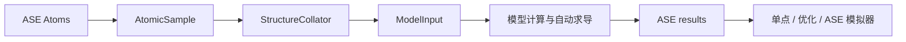
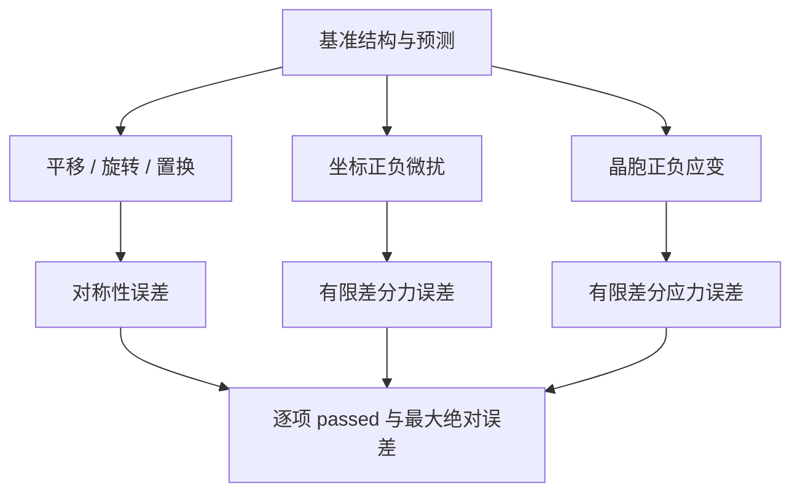

# ASE 推理与物理一致性检查

## ASE 用法

```python
from ase.io import read
from ase.optimize import BFGS
from abfml.interfaces import ABFMLCalculator

atoms = read("structure.extxyz")
atoms.calc = ABFMLCalculator("model.pt", device="cpu")
energy = atoms.get_potential_energy()
atomic_energies = atoms.get_potential_energies()
forces = atoms.get_forces()
stress = atoms.get_stress()  # 周期且晶胞满秩时可用

# 对适合优化的结构和已验证模型，可交给 ASE 的优化器。
optimizer = BFGS(atoms, logfile="optimization.log")
optimizer.run(fmax=0.05, steps=20)
```

计算器支持模型实例、标准模型文件和训练 checkpoint；精度默认沿用模型。
模型通过 `capabilities` 声明支持的输出，缺失的物理量不会返回伪造零值。



元素、位置、晶胞或 PBC 发生变化时，ASE 使旧结果失效并重新调用计算器。
外部邻居模型重新准备当前结构的邻居；internal/none 模型跳过这一过程。
不把训练用的无界几何缓存用于持续变化的模拟结构。

单位约定：长度 Å，能量 eV，力 eV/Å，virial 为 eV。应力使用
`stress = -virial / volume`，ASE 的六分量顺序为 `xx, yy, zz, yz, xz, xy`。
完整的边梯度公式、逐中心分配及符号约定见[理论文档第 6 节](theory.md#6-从能量到力和-virial)。
非周期或非满秩晶胞的应力请求会报错。力来自能量求导，因此推理不能使用
`torch.inference_mode()`；计算器内部显式启用自动微分。

## 物理一致性检查

```bash
# 自动生成测试结构，无需训练数据或参考标签
abfml check model.pt

# 也可指定某个实际结构
abfml check model.pt structures.extxyz --index 0 --step 1e-5 --atol 1e-5 --rtol 1e-4
```

默认按模型的 `type_map`、截断半径和元素共价半径生成周期结构，固定随机种子为 0，
每种元素至少出现两次，并添加小幅位置扰动以打破对称性。未声明 `type_map` 的模型
需要显式提供结构。此过程不读取 checkpoint 记录的训练数据。

检查统一使用 float64，以减小有限差分的舍入误差。日志打印模型、设备、精度、结构信息，
以及逐项 PASS/FAIL、最大绝对误差和总耗时。基准力接近零时会提示检查可能缺乏有效信息。
自动生成结构用于检验数学一致性，不代表真实材料构型或拟合精度，也不保证覆盖所有环境。

`check` 和 `evaluate` 均可通过 `--log-file check.log` 将日志同时保存到指定文件。
独立评估打印模型、设备、精度、结构数量、MAE/RMSE/相对误差表，以及输出位置和总耗时；
缺少配对参考标签时明确提示仅生成预测，不计算误差。

检查包括：

1. 平移后能量和力不变。
2. 旋转后能量不变，力和周期应力按相同旋转变换。
3. 同类原子交换编号后能量不变，力相应重排。
4. 总力接近零。
5. 模型力与能量对坐标的中心有限差分一致。
6. 周期体系中，模型应力与能量对应变的中心有限差分一致。



通过条件为逐分量 `abs(error) <= atol + rtol * abs(reference)`。
报告包含容差、步长、每项误差及跳过的应力检查；任何有效检查失败时 CLI 返回非零退出码。
命令默认检查一帧，适合先选小结构运行，因为有限差分需要多次能量计算。

这是针对给定结构附近的数值一致性检查，不是泛化精度或长时间 MD 稳定性认证。
外场模型可能不满足平移不变性或零总力；当前检查器面向无外场的常规保守 MLFF。
截断边界上的不连续、过小步长和 float32 舍入误差均可能导致检查失败，应结合报告分析。
