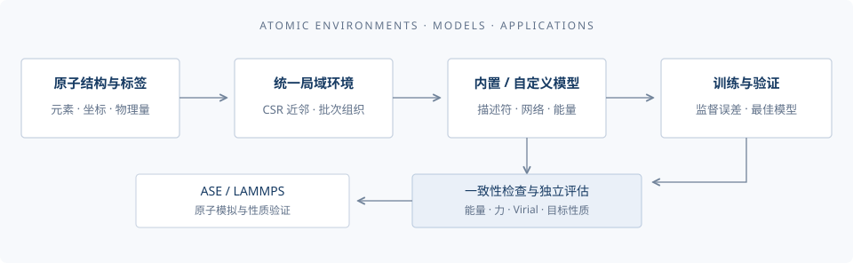

---
hide:
  - toc
---

<div class="home-hero" markdown>

<p class="eyebrow">MACHINE LEARNING FORCE FIELDS · PYTORCH</p>

# ABFML

<p class="lead">面向物理问题，构建与验证机器学习力场。</p>

<p class="description">从原子环境表示到自定义模型，从训练评估到原子模拟。ABFML 通过统一的数据与物理量接口，支持力场方法的开发、筛选和应用。</p>

[快速开始](quickstart.md){ .md-button .md-button--primary }
[探索模型与方法](custom.md){ .md-button }

</div>

<div class="entry-grid" markdown>

<div class="entry-card" markdown>

## 开始训练

安装环境、准备数据，完成训练与独立评估。

[安装与环境 →](install.md) · [配置与训练 →](training.md)

</div>

<div class="entry-card" markdown>

## 开发新模型

定义描述符与预测逻辑，复用训练和验证流程。

[自定义模型 →](custom.md) · [接口与注册 →](model-extension.md)

</div>

<div class="entry-card" markdown>

## 连接原子模拟

验证能量、力与 virial，衔接原子模拟和性质计算。

[ASE →](ase-and-checks.md) · [LAMMPS →](lammps.md)

</div>

</div>

## 从局域环境到力场应用

<figure class="framework-figure" markdown>



<figcaption>统一原子与近邻表示连接模型开发、数值验证和模拟应用；模型输出遵循相同的物理量约定。</figcaption>

</figure>

## 运行第一个示例

在项目根目录执行，以附带的 Cu 数据完成一轮 ACSF 训练：

```bash
python -m pip install -e .
abfml train examples/acsf/input.json --epochs 1
abfml check examples/acsf/results/best.pt
```

接下来可以[评估预测误差](evaluation.md)、[分析数据与描述符](tools.md)，或阅读[完整用户手册](manual.md)。该示例用于熟悉流程，一轮训练不代表模型已经收敛。

## 方法与实现

| 研究内容 | 文档 |
| --- | --- |
| 原子中心对称函数 | [ACSF 描述符与配置](acsf.md) |
| 可学习环境嵌入 | [DeepPot-SE](deepse.md) |
| 径向基与角向矩收缩 | [NEP](nep.md) |
| 能量导数和张量约定 | [力与 Virial](mechanics.md) |
| 变长结构、近邻图与模型契约 | [架构与数据流](architecture.md) |

## 论文与引用

X. Geng, J. Gu, G. Qin, L.-W. Wang, and X. Meng. **ABFML: A problem-oriented package for rapidly creating, screening, and optimizing new machine learning force fields.** *J. Chem. Phys.* **162**, 052502 (2025). [DOI: 10.1063/5.0247559](https://doi.org/10.1063/5.0247559)

[引用条目](project.md#引用) · [GPL-3.0-only](license.md) · [文档维护与发布](publishing.md)
