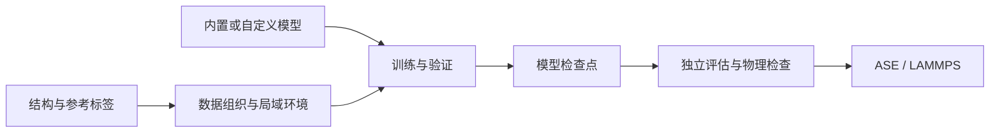

# ABFML 用户手册

本手册面向使用 ABFML 构建、训练、验证和应用机器学习力场的研究者，以当前仓库代码为准。建议第一次使用时按“安装 → 数据 → 训练 → 评估 → 物理检查 → 模拟”的顺序操作；开发新模型时阅读第 9 节。

手册参考了[原项目文档](https://github.com/gengxingze/ABFML/tree/master/docs)的阅读路线，命令、配置和接口已按当前实现重新整理。旧版模型文件和命令参数不保证兼容。

## 目录

1. [框架定位与工作流程](#1-框架定位与工作流程)
2. [安装与环境](#2-安装与环境)
3. [第一个完整流程](#3-第一个完整流程)
4. [准备结构与标签](#4-准备结构与标签)
5. [配置和训练模型](#5-配置和训练模型)
6. [模型评估与误差解释](#6-模型评估与误差解释)
7. [物理一致性检查](#7-物理一致性检查)
8. [绘图与数据分析](#8-绘图与数据分析)
9. [构建自定义模型](#9-构建自定义模型)
10. [通过 ASE 使用模型](#10-通过-ase-使用模型)
11. [通过 LAMMPS 使用模型](#11-通过-lammps-使用模型)
12. [问题排查与复现](#12-问题排查与复现)

## 1. 框架定位与工作流程

ABFML 基于 PyTorch，面向问题导向的机器学习力场开发。它既提供现成模型，也允许研究者定义描述符、网络和物理量预测逻辑，再复用数据组织、训练、评估与模拟接口。

使用模型时，通常先验证数据质量与模型数学一致性，再比较测试误差和目标材料性质，最后用于模拟。拟合误差小、物理一致性通过与模拟性质可靠，是三个需要分别检验的问题。



| 模型 | 配置中的 `model.name` | 示例 |
| --- | --- | --- |
| ACSF 原子神经网络 | `acsf` | `examples/acsf/` |
| DeepPot-SE 二体角度型 | `deep_pot_se_e2_a` | `examples/deepse2a/` |
| DeepPot-SE 二体径向型 | `deep_pot_se_e2_r` | `examples/deepse2r/` |
| DeepPot-SE 三体型 | `deep_pot_se_e3` | `examples/deepse3/` |
| NEP | `nep` | `examples/nep/` |
| Lennard-Jones | `lennard_jones` | `examples/lj/` |
| 自定义谐振对势 | `harmonic_pair` | `examples/harmonic/` |

不同模型需要的描述符和网络参数不同，请以各自示例配置为起点，公式见[模型理论](theory.md)。

## 2. 安装与环境

需要 Python 3.11 及以上。核心依赖包括 PyTorch、NumPy、ASE 和 Matplotlib。建议创建独立环境，在本地仓库根目录安装：

```bash
conda create -n abfml python=3.11
conda activate abfml
python -m pip install -e .
abfml --help
```

`-e` 为可编辑安装，修改源码后可在新启动的进程中生效。普通源码安装使用 `python -m pip install .`。本手册对应当前源码；使用发行版时应确认其版本和命令是否相同。

CPU 可以完成基本示例。GPU 环境需安装与驱动相匹配的 PyTorch，再在配置中指定 `training.device`。检查环境：

```bash
python -c "import torch, abfml; print('PyTorch:', torch.__version__); print('CUDA available:', torch.cuda.is_available())"
abfml train --help
abfml evaluate --help
abfml check --help
```

`python -m abfml` 与 `abfml` 为同一入口。除特别注明外，本手册的命令均在项目根目录执行。PowerShell 可以直接执行下文的单行命令；LAMMPS 编译部分使用 Linux Bash。

## 3. 第一个完整流程

使用仓库附带的 Cu 数据和 ACSF 配置：

```bash
abfml train examples/acsf/input.json --epochs 1 --log-file examples/acsf/results/train.log
abfml evaluate examples/acsf/results/best.pt examples/data/test.extxyz --output examples/acsf/results/evaluation
abfml check examples/acsf/results/best.pt
```

第一条命令用一轮训练验证流程是否正常，不代表模型已经充分收敛。示例配置将数据划分为训练集和验证集，输出到 `examples/acsf/results/`。

第二条命令演示评估接口，使用的是示例训练配置的数据来源，**不能把其结果当作独立测试集误差**。实际研究应另行准备未参与训练、模型选择和调参的测试数据。

第三条命令自动生成测试结构，检查对称性和能量导数一致性，不读取训练数据，也不需要参考标签。

| 输出 | 用途 |
| --- | --- |
| `config.json` | 本次运行配置 |
| `data.json` | 数据来源、摘要及划分索引 |
| `loss.out` | 逐 epoch 训练和验证指标 |
| `loss.png` | 同标签 Train/Valid 共轴的损失组图 |
| `last.pt` | 最近一次保存的训练状态 |
| `epoch_XXXX.pt` | 按间隔保存的训练状态 |
| `best.pt` | 监控指标最小的训练检查点 |
| `model.pt` | 最后一轮的标准推理模型 |
| `parity.png` | 满足结构数条件时生成的最佳模型预测组图 |

`best.pt` 和 `model.pt` 的权重不一定相同。希望应用验证集上最优权重时，应显式加载 `best.pt`。

## 4. 准备结构与标签

### 4.1 文件与单位

推荐使用 ASE 支持的 extended XYZ（`.extxyz`）格式。每帧包含元素、位置、晶胞、周期性以及已有参考标签。训练前应确认所有文件使用相同的单位、能量基准和元素定义。

| 内容 | 名称 | 内部单位 |
| --- | --- | --- |
| 总能量 | `energy` | eV |
| 原子力 | `forces` | eV/Å |
| 全局 virial | `virial` | eV |
| 原子电荷 | `charges` | e |
| 逐原子能量 | `atomic_energies` | eV |
| 总电荷 | `total_charge` | e |
| 偶极矩 | `dipole` | e·Å |

模型不必预测所有标签，但损失中启用的监督项需要同时存在预测和参考值。缺失标签不会自动填零。完整形状及扩展方式见[标签说明](labels.md)。

应力与 virial 的关系为 `stress = -virial / volume`。二者不能只改名称而不转换数值；导入 ASE 应力标签时由 Reader 按框架规则处理。请避免向文件同时写入互相矛盾的应力和 virial。

### 4.2 从 ASE 保存参考数据

如果 ASE 结构已经连接参考计算器，可以获取结果并写成 extxyz：

```python
from ase.io import read, write

atoms = read("reference.extxyz", index=0)
energy = atoms.get_potential_energy()
forces = atoms.get_forces()
write("sample.extxyz", atoms, format="extxyz")
```

这里的输入必须已经包含参考结果或连接了可计算结果的计算器。`write` 不会自动产生 DFT 标签；不含标签的结构仅能用于预测或几何分析。

### 4.3 划分和数据组织

配置可使用 `data.files` 配合 `data.split` 固定划分，也可显式提供 `train_files` 和 `valid_files`。相邻 MD 帧常高度相关，研究时应按轨迹、温度、相或构型来源设计划分，不能只依赖随机拆分。

内部流程为 `ASEReader → AtomicDataset → StructureCollator → ModelInput`。变长结构展平存储，近邻采用 CSR 表示；需要固定邻居维度的模型再获得 Dense 视图。`neighbor_cache="memory"` 可复用固定结构的近邻，代价是额外内存，不适合无界增长的数据规模。

## 5. 配置和训练模型

### 5.1 配置结构

| 配置段 | 主要设置 |
| --- | --- |
| `common` | 元素、精度、随机种子 |
| `model_modules` | 自定义模型模块，可选 |
| `model` | 注册名及模型参数 |
| `data` | 数据路径、划分、批量与近邻缓存 |
| `training` | 设备、轮数、优化器、调度器、梯度裁剪及日志间隔 |
| `loss` | 标签、误差类型与权重 |
| `output` | 结果目录、模型名及检查点策略 |

下面是一份可保存在**项目根目录 `input.json`** 的完整 LJ 演示配置，用于理解字段及运行流程。LJ 的表达能力有限，不应将该示例视为 Cu 的可靠势函数。

```json
{
  "config_version": 1,
  "common": {"elements": ["Cu"], "dtype": "float64", "seed": 2026},
  "model": {"name": "lennard_jones", "cutoff": 5.0, "epsilon": 0.1, "sigma": 2.0},
  "data": {
    "files": ["examples/data/test.extxyz"],
    "format": "extxyz",
    "split": {"train": 0.8, "valid": 0.2, "seed": 2026},
    "loader": {"batch_size": 2, "shuffle": true, "neighbor_cache": "memory"}
  },
  "training": {
    "device": "cpu",
    "epochs": 10,
    "optimizer": {"name": "adam", "learning_rate": 0.001},
    "gradient_clip_norm": 10.0,
    "print_freq": 1
  },
  "loss": {
    "metric": "mse",
    "label": ["energy", "forces", "virial"],
    "start_weight": [1.0, 1.0, 0.1],
    "limit_weight": [1.0, 1.0, 0.1]
  },
  "output": {
    "dir": "runs/manual",
    "model_filename": "model.pt",
    "checkpoint": {"save_every": 1, "keep_best": true, "monitor": "valid_loss"}
  }
}
```

数据路径和输出目录相对于 **JSON 文件所在目录** 解析。移动配置文件后，需要相应调整这些路径。

### 5.2 启动、续训与微调

```bash
abfml train input.json --log-file runs/manual/train.log
abfml train input.json --resume runs/manual/last.pt --epochs 10
abfml train input.json --fine-tune runs/manual/best.pt --epochs 10
```

`--epochs` 表示本次新增的训练轮数。续训恢复模型、优化器等训练状态，并检查数据与配置的一致性；微调加载模型和已保存统计量，重新开始优化器与训练计数。两种模式互斥。

训练设备由 `training.device` 设置，如 `cpu` 或 `cuda:0`；精度由 `common.dtype` 指定为 `float32` 或 `float64`。`print_freq` 按 batch 计数，epoch 末仍有汇总。

### 5.3 损失、最佳模型与日志

总损失由各标签误差按权重组合。能量及 virial 残差先按每个结构的原子数归一化，力按笛卡尔分量统计。权重反映监督项之间的尺度及关注程度，不同权重下的总 loss 不能直接横向比较。

验证采用固定的终止权重。默认监控 `valid_loss`，数值更小则更新 `best.pt`；当前监控策略按最小值选择模型。

日志包含模型结构、参数量、运行环境、设备与精度、训练误差及阶段耗时。`--log-file` 同时追加保存日志；`loss.out` 始终承担逐 epoch 指标记录。

训练结束自动绘制 `loss.png`。训练和验证的合计结构数 **小于 500,000** 时，用最佳检查点生成一张 `parity.png`，同标签 Train/Valid 共用子图；不另存训练/验证预测文件。达到阈值时跳过预测组图，仍计算最终汇总指标。没有可用最佳检查点时使用最终权重，具体以日志为准。

更多配置与恢复约束见[工作流说明](workflows.md)，ACSF 参数见[ACSF 专题](acsf.md)。

## 6. 模型评估与误差解释

```bash
abfml evaluate examples/acsf/results/best.pt examples/data/test.extxyz --output evaluation --batch-size 8 --device cpu
```

可在模型后提供多个结构文件，按合并后的数据统计。模型可以是标准文件或检查点，评估不需要 `input.json`。如需严格要求标签，可添加 `--labels energy forces`。

默认 CLI 输出目录为 `evaluation`，保存一个 `predictions.extxyz` 和存在可匹配参考标签时的一张 `parity.png`。前者包含几何信息，以及 `ref_*` 参考值和 `pred_*` 预测值。没有参考标签时执行预测，日志明确说明无法计算误差，不会伪造零误差。

指标按全部样本的标量分量累计，设预测误差为 Δ，分量总数为 M：

```text
MAE      = sum(abs(Δ)) / M
RMSE     = sqrt(sum(Δ²) / M)
Rel. (%) = 100 * RMSE / mean(abs(reference))
```

这里的相对误差是用参考绝对值均值归一化的 RMSE，不是逐点相对误差的平均。分母为零时显示 `N/A`。力的 `Count` 为笛卡尔分量数，不能当作原子数。

日志对能量和 virial 优先显示每原子指标，对力显示分量指标，常用单位为 meV/atom、meV/Å。Python 返回报告中的 MAE/RMSE 使用框架内部单位，如 eV、eV/Å，并保留总量及每原子指标。

```python
from abfml.workflows.evaluate import evaluate

report = evaluate("examples/acsf/results/best.pt", "examples/data/test.extxyz", batch_size=8)
print(report["metrics"])
```

Python 调用默认不保存文件；传入 `output_dir="evaluation"` 才保存预测与组图。独立测试还应覆盖实际关注的性质，如能量排序、状态方程、弹性、缺陷或相稳定性。

## 7. 物理一致性检查

```bash
abfml check examples/acsf/results/best.pt
abfml check examples/acsf/results/best.pt examples/data/test.extxyz --index 0
```

不指定结构时，根据模型元素、截断半径和共价半径自动生成非对称周期结构，固定随机种子为 0，每种元素至少出现两次。未声明 `type_map` 的模型需显式提供结构。

检查统一使用 float64，包括：

- 平移不变性，以及旋转时能量不变、力和应力协变。
- 同类原子置换后的能量与力一致性。
- 总力接近零。
- 力与能量对位置的中心有限差分一致性。
- 具备 virial 和周期满秩晶胞时，应力与能量对应变的有限差分一致性。

可通过 `--step`、`--atol`、`--rtol` 调整步长及容差，通过条件为逐分量 `abs(error) <= atol + rtol * abs(reference)`。日志列出 PASS/FAIL、最大误差、跳过原因和总耗时；失败时 CLI 返回非零退出码。

零力、无有效相互作用或特殊对称构型可能使检查缺乏信息。截断不连续及微扰跨越截断也可能引起失败。通过检查表示当前测试构型附近满足这些数值约束，不等价于拟合准确或长时间动力学稳定。详见[ASE 与检查](ase-and-checks.md)。

## 8. 绘图与数据分析

分析工具通过 `abfml plot` 调用，不读取 `input.json`。默认在当前目录保存一张 PNG 组图并打印统计，不额外导出 CSV/NPZ。

```bash
abfml plot labels examples/data/test.extxyz
abfml plot labels --dataset A=examples/data/structures.extxyz --dataset B=examples/data/test.extxyz
abfml plot neighbors examples/data/test.extxyz --cutoff 4 5 6 --slots 100
abfml plot descriptors --model examples/acsf/results/best.pt --dataset test=examples/data/test.extxyz --level atom
abfml plot descriptors --model examples/acsf/results/best.pt --dataset test=examples/data/test.extxyz --level structure
abfml plot predictions evaluation/predictions.extxyz
abfml plot pairs evaluation/predictions.extxyz --label forces --output forces.csv
```

| 子命令 | 结果及主要用途 |
| --- | --- |
| `labels` | `labels.png`；单组分布或多组同标签对比 |
| `neighbors` | `neighbors.png`；不同 cutoff 下的邻居数量统计 |
| `descriptors` | `descriptors.png`；描述符 PCA 及通道统计 |
| `predictions` | `parity.png`；从已有预测文件重绘，不调用模型 |
| `pairs` | 两列 `reference,prediction` CSV，供自行绘图 |

邻居统计中的最小值、最大值和 P95 是**邻居数量**。`--slots` 仅计算容量溢出比例，不裁剪邻居。

描述符默认每原子一个点；`--level structure` 在原始描述符空间先对结构中心取均值，再做 PCA。模型需返回 `properties["descriptors"]`。大数据应先抽样，以控制完整 SVD 的内存开销。

`labels`、`neighbors` 和 `descriptors` 添加 `--output` 时才额外导出数值，`--output DIR` 同时指定目录。`predictions --output DIR` 只指定绘图目录；`pairs --output FILE` 指定 CSV 文件名。

损失曲线在训练结束自动生成，也可通过 Python 重绘：

```python
from abfml.tools import plot_loss
plot_loss("examples/acsf/results/loss.out")
```

同名输出文件会覆盖，完整参数见[工具说明](../abfml/tools/README.md)。

## 9. 构建自定义模型

### 9.1 开发步骤

自定义模型通常由一个 Python 模块组织模型逻辑、配置解析和注册语句。框架不要求为每个模型修改 CLI 或添加名称判断分支。

1. 继承 `AtomicModel`，声明支持的物理量及几何、近邻模式。
2. 实现 `compute(inputs)`，返回 `ModelOutput`。
3. 定义配置类，实现 `from_dict(...)` 和 `model_kwargs()`。
4. 用 `ModelSpec` 将构造器与配置类绑定并注册。
5. 在完整训练配置中声明 `model_modules`，之后执行训练、重载和一致性检查。

完整单文件示例见 [harmonic.py](../examples/harmonic/harmonic.py)，其中的核心能量计算为：

```python
from abfml.core.model import AtomicModel
from abfml.core.types import ModelInput, ModelOutput
from abfml.builtin.functions import segment_sum

class HarmonicPair(AtomicModel):
    # 完整示例中的 __init__ 定义参数 stiffness、equilibrium 和 cutoff。
    capabilities = ("energy", "atomic_energies", "forces", "virial")

    def compute(self, inputs: ModelInput) -> ModelOutput:
        _, edge_ptr, _, vectors = inputs.require_neighbors()
        distances = vectors.square().sum(dim=-1).clamp(min=1.e-24).sqrt()
        edge_energy = 0.25 * self.stiffness * (distances - self.equilibrium) ** 2
        atomic_energy = segment_sum(edge_energy, edge_ptr)
        return ModelOutput(energy=atomic_energy.sum(), atomic_energies=atomic_energy)
```

该片段展示计算接口，不能代替完整模块。完整示例已包含参数和配置定义，可直接导入使用。有向近邻表中每个原子对出现两次，因此每条边分配一半的配对能量。谐振示例未平滑截断，用于演示扩展契约。

### 9.2 注册与配置

```python
from abfml.core.registry import ModelSpec, register_model

# HarmonicPair 与 HarmonicPairConfig 均在完整示例模块中定义。
register_model("harmonic_pair", ModelSpec(HarmonicPair, HarmonicPairConfig))
```

`ModelSpec` 描述“如何解析配置、如何构造模型”，不承载训练循环。外部模块导入时完成注册，工作流再按 `model.name` 查找对应项。

以第 5 节的完整配置为基础，添加或替换以下两个顶层字段，其余字段保留：

```json
{
  "model_modules": ["examples.harmonic.harmonic"],
  "model": {
    "name": "harmonic_pair",
    "cutoff": 3.0,
    "stiffness": 0.2,
    "equilibrium": 1.0
  }
}
```

在项目根目录执行训练。`model_modules` 使用 Python 模块名；加载配置时也会把配置所在目录加入搜索路径。正式扩展建议安装为可导入包，并在模型迁移后保持扩展代码可用。模型文件保存模块信息，不应把它理解为自动打包全部第三方代码及依赖。

### 9.3 输入和输出契约

| `ModelInput` 字段 | 含义 |
| --- | --- |
| `atomic_numbers` | 存储原子的原子序数，`[N]` |
| `center_indices` | 能量中心索引，`[C]` |
| `edge_ptr` | 各中心的边区间，`[C+1]` |
| `neighbor_indices` | 边对应的邻居索引，`[E]` |
| `edge_vectors` | `r_j - r_i`，`[E,3]`，包含周期像 |
| `atom_ptr`、`center_batch` | 批次结构边界及中心所属结构 |

标签不混入几何输入。可微能量模型可复用力和 virial 的求导；直接预测力的模型需声明相应模式并提供所需输出。可学习参数使用 `nn.Parameter`，需要随模型保存和迁移的固定统计量使用 `register_buffer`。

新标签通过 `ModelOutput.properties` 和统一标签说明扩展；只添加标签名称不会自动完成数据映射、模型预测或训练监督。更完整的开发约束见[模型扩展](model-extension.md)及[架构说明](architecture.md)。

## 10. 通过 ASE 使用模型

```python
from ase.io import read
from abfml.interfaces import ABFMLCalculator

atoms = read("examples/data/test.extxyz", index=0)
atoms.calc = ABFMLCalculator("examples/acsf/results/best.pt", device="cpu")
print(atoms.get_potential_energy())
print(atoms.get_forces())
print(atoms.get_stress())
```

Calculator 默认沿用模型精度，也可传入 `dtype=torch.float64`。应力要求模型提供 virial，且结构具有周期性和满秩晶胞。ASE 的六分量应力顺序为 `xx yy zz yz xz xy`。

ASE 会在结构发生变化后请求新结果，外部邻居由接口准备。计算器可接入 ASE 优化器及模拟器；具体方法、步长及边界条件应按体系选择。

能量求导力需要自动微分，不应在调用外层使用 `torch.inference_mode()`。更多示例见[ASE 与物理检查](ase-and-checks.md)。

## 11. 通过 LAMMPS 使用模型

### 11.1 编译与环境

LAMMPS 需要启用 MPI、共享库和 `PLUGIN` 包，之后单独编译 `lmp/ABFML`。插件嵌入当前 Python 环境，运行时需要安装 ABFML 及对应扩展模块。完整环境准备、CMake 命令及报错处理见 [LAMMPS 接口文档](../lmp/ABFML/README.md)。

### 11.2 最小输入

以下示例在包含 `data.lmp`、`model.pt` 的目录执行；替换实际插件路径：

```lammps
units metal
atom_style atomic
newton on
read_data data.lmp
mass * 63.546

plugin load /absolute/path/ABFML/lmp/ABFML/build/libabfml.so
pair_style abfml model.pt cpu mode eager precision float64
pair_coeff * * Cu
thermo 1
thermo_style custom step atoms pe press pxx pyy pzz pxy pxz pyz
run 0
```

```bash
/path/to/lammps/build/lmp -in in.lmp
mpiexec -n 4 /path/to/lammps/build/lmp -in in.lmp
```

并行命令在已分配的计算资源中运行，并按集群要求选择启动器。

### 11.3 参数和适用范围

语法为 `pair_style abfml MODEL [DEVICE] [mode eager|compile] [precision float32|float64]`。默认 **cpu、eager、float32**，与 ASE 默认沿用模型精度不同。

`pair_coeff * * Cu O` 按 LAMMPS 原子类型顺序填写元素符号，不接受原子序数。桥模块已经随 Python 包安装，不再传入桥文件目录。

模型需使用 local 几何、external 邻居，支持本地中心和 local/ghost 原子的计算。每个 MPI 进程加载一份模型；不能仅凭注册成功就认为所有多层消息传递模型均适合当前分域方式。

逐原子 virial 使用中心归属九分量，通过 `centroid/stress/atom NULL virial` 读取；全局六分量取完整张量的对称部分。原始 virial、LAMMPS 应力及单位换算见接口文档。

`compile` 为可选项，需先预热再测量；首次编译、CPU/GPU 数据复制和进程数都会影响速度。模型检查通过后，建议在相同精度与构型下对照 Python 和 LAMMPS 的单进程及多进程结果。

## 12. 问题排查与复现

| 现象 | 优先检查 |
| --- | --- |
| 找不到命令或模块 | 当前 Python 环境、安装位置及 `python -m abfml --help` |
| 读取不到标签 | 文件是否真的包含参考标签、字段名、格式及 ASE 可读性 |
| 配置路径无效 | 路径相对于 JSON 文件所在目录，而非命令执行目录 |
| 邻居容量不足 | cutoff、结构密度、各元素槽位和近邻统计，不应静默丢边 |
| best 与最终结果不同 | 比较的是否分别为 `best.pt` 和最后一轮 `model.pt` |
| `check` 有限差分失败 | 查看具体检查项、步长、截断连续性及模型导数实现 |
| 自定义模型无法重载 | 扩展模块是否可导入、注册名与配置是否一致 |
| 图形没有数值文件 | 工具默认仅保存一张 PNG，需要显式 `--output` 才导出数值 |
| LAMMPS 加载失败 | 编译器/MPI/Python 环境、共享库路径及插件文档 |

复现实验时至少保留配置、代码版本、依赖版本、数据来源与划分、模型检查点和运行日志。GPU、并行计算和后端差异可能影响数值与时间，性能报告应同时给出硬件、精度、进程数、体系大小及是否包含预热。

项目测试可在根目录运行：

```bash
python -m unittest discover -s tests -t .
```

### 进一步阅读与引用

[数据组织](data.md) · [标签与单位](labels.md) · [模型理论](theory.md) · [工作流](workflows.md) · [模型扩展](model-extension.md) · [分析工具](../abfml/tools/README.md)

项目论文：[ABFML: A problem-oriented package for rapidly creating, screening, and optimizing new machine learning force fields](https://doi.org/10.1063/5.0247559)，J. Chem. Phys. **162**, 052502 (2025)。引用条目见[项目 README](../README.md#引用)。当前仓库许可证为 [GPL-3.0-only](../LICENSE)。
