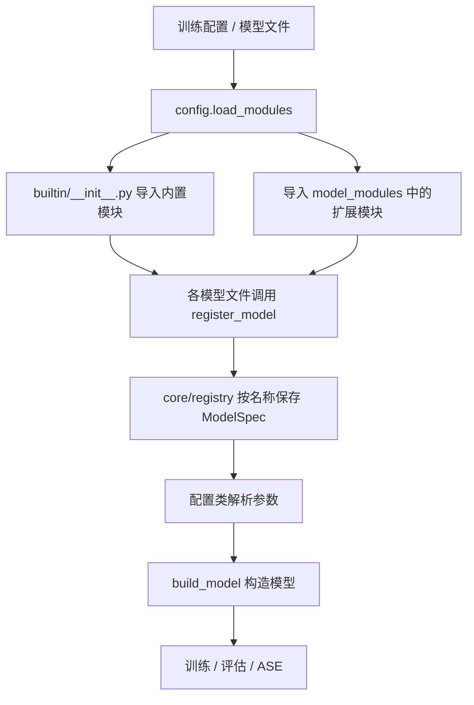

# 新增模型与自注册

每个模型文件包含配置解析、描述子、网络组织、模型类和注册语句。
`core/registry.py` 只维护注册机制，不导入 ACSF、DeepPot-SE、NEP 或外部模型。



## 模型文件的组织

| 模型文件 | 模型类 | 配置中的 `model.name` |
|---|---|---|
| `builtin/acsf.py` | `ACSFModel` | `acsf` |
| `builtin/deepse.py` | `DeepPotSE2A` | `deep_pot_se_e2_a` |
| `builtin/deepse.py` | `DeepPotSE2R` | `deep_pot_se_e2_r` |
| `builtin/deepse.py` | `DeepPotSE3` | `deep_pot_se_e3` |

配置类分别为 `ACSFConfig`、`DeepPotSE2AConfig`、`DeepPotSE2RConfig` 和
`DeepPotSE3Config`。旧模块路径、类名和注册名不提供兼容别名；旧模型文件及检查点
中记录的注册名也不会自动迁移。

内置文件分别是 `builtin/acsf.py`、`builtin/deepse.py`、`builtin/nep.py`。
DeepPot-SE 的三个变体仍在同一个文件中，分别注册三个名称。以 ACSF 为例：

```python
from abfml.core.registry import ModelSpec, register_model

# ACSFModel 和 ACSFConfig 的完整定义位于同一个文件。
register_model("acsf", ModelSpec(ACSFModel, ACSFConfig))
```

新增内置模型只需添加一个模型文件，并在 `builtin/__init__.py` 显式导入它。
不需要修改注册表、CLI、模型名称分支或维护另一份配置映射。

注册项包含构造器和配置类。构造器返回 `AtomicModel`；配置类实现
`from_dict(raw, *, type_map, path)`、`cutoff` 和 `model_kwargs()`。
纯 Python 使用可以省略 `ModelSpec.config`，通过 JSON 训练或从模型文件恢复则需要它。
同名注册直接报错，避免覆盖已有模型。普通重复导入由 Python 缓存模块，不会重复注册。

## 外部模型

[harmonic.py](../examples/harmonic/harmonic.py) 是完整的单文件扩展示例，包含一个
谐振双体势、参数解析和注册语句。它用于演示接口，截断处没有平滑处理。

在完整训练配置中加入模块名，并替换 `model` 段：

```json
{
  "model_modules": ["examples.harmonic.harmonic"],
  "model": {
    "name": "harmonic_pair",
    "cutoff": 3.0,
    "stiffness": 0.2,
    "equilibrium": 1.0
  }
}
```

在项目根目录运行 `python -m abfml train input.json` 即可导入此示例。
实际扩展可用 `my_package.harmonic`，并正常安装该包或配置 `PYTHONPATH`。
模块名遵循 Python 导入规则，不是相对于 JSON 的文件路径。加载配置时会把配置文件
所在目录加入模块搜索路径。加载模块会执行其中的 Python 代码，包括注册语句；项目不扫描模型目录。

`model_modules` 会写入标准模型文件和训练检查点；独立评估、ASE 和续训在解析模型
配置前加载这些模块。迁移模型文件时也需要在目标环境安装相应扩展包。
续训会校验模块列表与保存时一致。

直接在 Python 中使用时，先导入模型模块再构建：

```python
import examples.harmonic.harmonic
from abfml.core.registry import build_model

model = build_model("harmonic_pair", type_map=[1], cutoff=3.0,
                    stiffness=0.2, equilibrium=1.0)
```

使用内置模型时，先 `import abfml.builtin`。通过训练配置或 `load_model` 进入时，
应用层自动完成导入。单独导入 `abfml.core.registry` 不会加载任何具体模型或 ASE。

## 数据与模型的接口

模型声明 `neighbor_mode` 为 `external`、`internal` 或 `none`。外部邻居模型可复用
数据层构建器和缓存；自己构建邻居的模型声明 `internal`，数据层会跳过外部建边。
`compute()` 接收 `ModelInput` 并返回 `ModelOutput`；标签留在训练和评估工作流中。

模型参数和统计量分别用 `nn.Parameter`、`register_buffer` 保存，以便设备迁移和
`state_dict` 恢复。现有训练统计初始化支持 `required_statistics` 已定义的几种约定；
增加全新的校准协议仍需扩展训练初始化流程，注册机制本身不会自动推断它。
本次没有加入编译导出逻辑。
