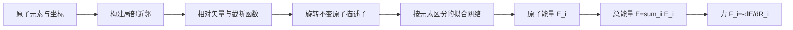
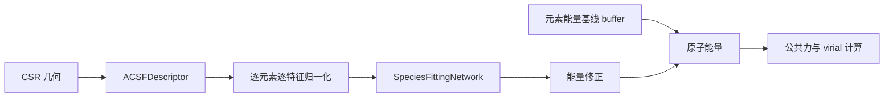
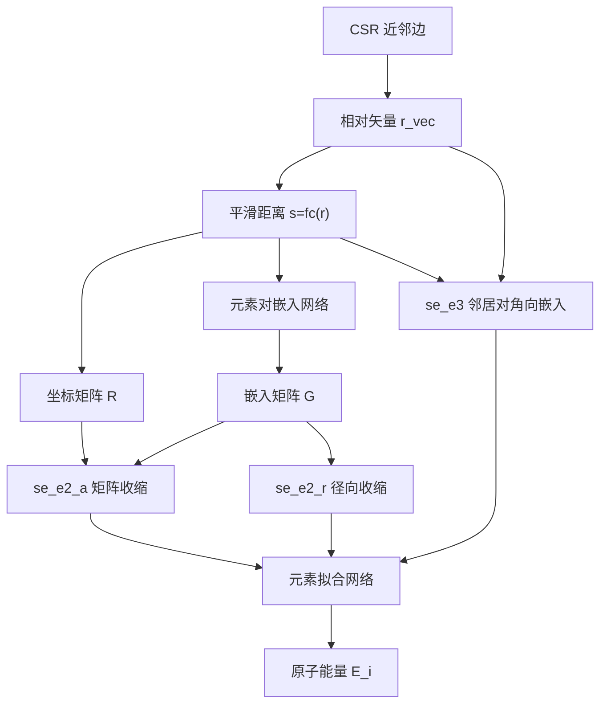
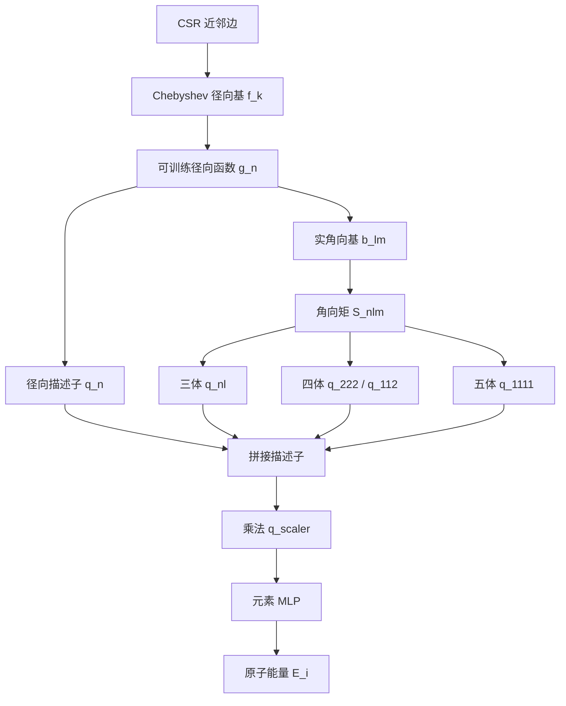
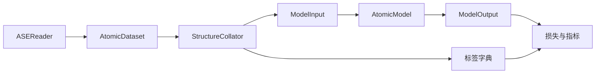

# ABFML 重构：模型理论、数据组织与工程笔记

本文整理当前重构代码中三类机器学习原子势的核心思想：

- 基于原子中心对称函数（ACSF）的 Behler–Parrinello 类型神经网络势；
- Deep Potential Smooth Edition（DeepPot-SE）；
- 神经演化势（NEP）。

重点不是逐行翻译代码，而是回答四个问题：

1. 模型如何从局部原子环境构造旋转不变描述子？
2. 描述子如何映射为原子能量、总能量和力？
3. 论文公式与当前 Python 变量如何对应？
4. 结构、邻居、batch 与模型接口应如何组织？

除模型理论外，本文持续记录讨论后确定的工程方案，方便后续重新理解与查阅。
已经实现的代码行为与尚待实现的设计会明确区分。

> 本文公式优先与当前实现保持一致。遇到当前 ABFML 约定与原始论文或官方文档不完全一致时，会单独标出。

---

## 1. 三类模型共同的物理框架

### 1.1 从局部环境到总能量

三类模型都采用原子能量分解：

\[
E=\sum_i E_i,
\]

其中，原子能量 \(E_i\) 由中心原子 \(i\) 的局部环境决定：

\[
E_i=\mathcal F_{I_i}(\mathbf d_i).
\]

这里：

- \(I_i\) 是中心原子的元素；
- \(\mathbf d_i\) 是局部环境描述子；
- \(\mathcal F_{I_i}\) 通常是按中心元素区分参数的神经网络。

局部环境由邻居相对矢量和元素组成：

\[
\mathbf r_{ij}=\mathbf R_j-\mathbf R_i,
\qquad
r_{ij}=\|\mathbf r_{ij}\|,
\qquad
\hat{\mathbf r}_{ij}=\frac{\mathbf r_{ij}}{r_{ij}}.
\]

在周期体系中，\(\mathbf r_{ij}\) 还必须包含周期镜像位移。当前框架把近邻构建与模型计算分开：模型接收 CSR 边和边矢量，不负责重新判断周期近邻。

### 1.2 为什么不能直接把坐标送入普通神经网络

物理能量应满足：

- **平移不变性**：所有原子一起平移，能量不变；
- **旋转不变性**：整个体系旋转，能量不变；
- **同类原子置换不变性**：交换同类原子编号，能量不变；
- **平滑性**：邻居进入或离开截断区域时，能量和力不应突变。

因此，模型先把坐标变换成具有相同对称性的描述子，再计算能量。

### 1.3 统一计算流程



当前三个模型都没有采用多轮消息传递。它们的主要差别在于：**如何构造原子描述子 \(\mathbf d_i\)**。

### 1.4 常用符号

| 符号 | 含义 |
|---|---|
| \(C\) | 当前计算的中心原子数 |
| \(M\) 或 \(N_c\) | 每个中心的定长邻居槽位总数；分元素布局中为各元素槽位数之和 |
| \(T\) | 元素种类数 |
| \(I,J\) | 中心元素和邻居元素 |
| \(r_{ij}\) | 中心—邻居距离 |
| \(f_c(r)\) | 平滑截断函数 |
| \(H\) | 嵌入或隐藏层宽度 |
| \(\mathbf d_i\) | 泛指原子描述子 |
| \(E_i\) | 原子能量 |

---

## 2. ACSF：指数型 ACSF 与元素拟合网络

当前 ACSF 使用 `ACSFModel`，包含高斯径向 `radial_gaussian`、窄角向
`angular_narrow` 和宽角向 `angular_wide` 三种描述子。窄角向包含邻居间距离
r_jk，宽角向不包含；两者均只累计不同邻居槽位 j<k，按无序元素对组织通道。



`ACSFDescriptor` 负责邻居视图、描述子拼接、`output_dim` 和 `feature_layout`。
基函数按 `descriptor.blocks[].basis[]` 逐条定义；维度自动推导。
角向 K 组基函数占 K*T*(T+1)/2 列，径向 K 组占 K*T 列。
训练统计在已有描述子实例上计算，近常量通道仅减均值，不放大波动。

完整公式、配置示例、参数约束、特征顺序与校准流程见
[ACSF 配置与模型说明](acsf.md)。旧 ACSF 构造参数和旧模型状态不提供兼容入口。

---

## 3. DeepPot-SE：可学习嵌入与矩阵收缩

### 3.1 核心理解

DeepPot-SE 的基本思想是：

> 先用嵌入网络把邻居距离映射成高维向量，再通过坐标矩阵与嵌入矩阵的收缩构造平滑、旋转不变的描述子。

与 ACSF 相比，它不是只使用固定对称函数，而是让嵌入网络参与描述子的构造。



代码文件：`deepse.py`。

三个 DeepPot-SE 模型使用按 `type_map` 顺序排列的分元素邻居槽位。未提供
`type_slots` 时，每种元素分配相同的 `max_neighbors` 个槽位，总宽度为
\(M=T\times\text{max\_neighbors}\)；提供 `type_slots=[M_1,\ldots,M_T]` 时，
各元素使用指定宽度，且 \(M=\sum_t M_t\)。padding 只用于对齐，不参与嵌入或求和。

### 3.2 平滑坐标矩阵

令：

\[
s_{ij}=f_c(r_{ij}).
\]

se_e2_a 和 se_e3 使用的坐标矩阵每一行为：

\[
\mathbf R_{ij}
=
\left(
s_{ij},
\frac{s_{ij}x_{ij}}{r_{ij}},
\frac{s_{ij}y_{ij}}{r_{ij}},
\frac{s_{ij}z_{ij}}{r_{ij}}
\right).
\]

因此：

\[
R\in\mathbb R^{C\times M\times4}.
\]

se_e2_r 只保留第一列：

\[
R_{ij}=(s_{ij}),
\qquad
R\in\mathbb R^{C\times M\times1}.
\]

代码变量：

| 公式 | 代码变量 |
|---|---|
| \(\mathbf r_{ij}\) | `r_vec` |
| \(r_{ij}\) | `r` |
| \(1/r_{ij}\) | `inv_r` |
| \(s_{ij}\) | `s` |
| 坐标矩阵 \(R\) | `r_matrix` |

坐标矩阵按中心元素统计量归一化。归一化后必须再次清零 padding，否则“零坐标减非零均值”会让无效槽位获得伪坐标。

### 3.3 可学习嵌入矩阵

距离标量经过由中心元素和邻居元素共同决定的嵌入网络：

\[
\mathbf G_{ij}
=
\operatorname{Embedding}_{I_i,J_j}(s_{ij}),
\qquad
\mathbf G_{ij}\in\mathbb R^H.
\]

因此：

\[
G\in\mathbb R^{C\times M\times H}.
\]

代码中由 `_embed_species()` 计算，变量为 `g_ij`。padding 槽位严格保持为零。

### 3.4 se_e2_a：完整坐标与嵌入矩阵收缩

先计算：

\[
A=\frac{R^TG}{N_c},
\qquad
A\in\mathbb R^{C\times4\times H}.
\]

代码变量 `rT_g` 即矩阵 \(A\)。

再取 \(A\) 的前 \(M_2\) 个嵌入通道，记为 \(A_<\)，构造：

\[
D_i=A^TA_<
=\frac{(G^TR)(R^TG_<)}{N_c^2}.
\]

其形状为：

\[
D_i\in\mathbb R^{H\times M_2},
\]

展开后作为拟合网络输入。

为什么旋转不变？若所有相对矢量经过旋转：

\[
\mathbf r_{ij}\rightarrow Q\mathbf r_{ij},
\]

则方向部分相应左乘 \(Q\)，而收缩中两个方向矩阵以转置形式相乘：

\[
Q^TQ=I.
\]

绝对方向因此在矩阵收缩中消去，保留的是相对几何关系。

### 3.5 se_e2_r：纯径向嵌入

当前 ABFML 实现为：

\[
D_i
=
\frac{1}{N_c^2}
\left(\sum_j\mathbf G_{ij}\right)^2,
\qquad
D_i\in\mathbb R^H.
\]

平方逐通道进行。

> **重要区别**：DeePMD-kit 文档展示的径向描述子形式为 \(\sum_jG_{ij}/N_c\)。当前实现保留原 ABFML 的“求和后平方再除 \(N_c^2\)”约定，不能直接声称与官方 se_e2_r 公式或权重完全兼容。

### 3.6 se_e3：邻居对角向嵌入

se_e3 先计算：

\[
\cos\theta_{ijk}
=
\frac{\mathbf r_{ij}\cdot\mathbf r_{ik}}
{r_{ij}r_{ik}},
\]

再定义：

\[
\vartheta_{ijk}
=
s_{ij}s_{ik}\cos\theta_{ijk}.
\]

代码中用 `theta` 表示 \(\vartheta_{ijk}\)，用 `g_theta` 表示其嵌入。

描述子为：

\[
D_i
=
\frac{1}{N_c^2}
\sum_{j,k}
\vartheta_{ijk}\,
\operatorname{Embedding}_{I_i,J_j}(\vartheta_{ijk}).
\]

实现时先对每个固定的 \(j\) 沿 \(k\) 求和，再通过 `index_add` 聚合到中心原子，避免生成完整的 \([C,M,M,H]\) 大张量。

### 3.7 拟合网络

三种变体最后都使用按中心元素区分的拟合网络：

\[
E_i=\operatorname{Fitting}_{I_i}(D_i).
\]

代码变量：

- `d_i`：描述子 \(D_i\)；
- `e_i`：原子能量 \(E_i\)。

---

## 4. NEP：可训练径向函数与角向矩收缩

### 4.1 核心理解

NEP 的基本思想是：

> 用可训练的径向函数收集邻居信息，先形成角向矩，再把角向矩收缩成三体、四体和五体旋转不变量，最后通过元素神经网络预测原子能量。

NEP 的关键不只是“使用单隐层神经网络”，而是其描述子的构造方式。



代码文件：`nep.py`。

### 4.2 Chebyshev 径向基

定义：

\[
x=2\left(\frac{r}{R_c}-1\right)^2-1,
\]

\[
T_0(x)=1,
\qquad
T_1(x)=x,
\qquad
T_{k+1}(x)=2xT_k(x)-T_{k-1}(x).
\]

截断函数为：

\[
f_c(r)=\frac12\left[\cos\left(\pi\frac{r}{R_c}\right)+1\right].
\]

NEP 的径向基为：

\[
f_k(r)=\frac{T_k(x)+1}{2}f_c(r),
\qquad k=0,\ldots,K.
\]

代码函数：`radial_basis()`；局部变量为 `f_k_radial` 和 `f_k_angular`。

### 4.3 可训练径向函数

NEP 对径向基作可训练线性组合：

\[
g_n^{IJ}(r_{ij})
=
\sum_{k=0}^{K}c_{nk}^{IJ}f_k(r_{ij}).
\]

这里系数同时依赖中心元素 \(I\) 和邻居元素 \(J\)。当前系数张量形状为：

\[
[T,T,N,K+1].
\]

代码变量：

- `c_nk_radial`、`c_nk_angular`：展开系数；
- `g_n_radial`、`g_n_angular`：组合后的径向函数。

径向描述子为：

\[
q_n^i=\sum_jg_n^{IJ}(r_{ij}),
\]

对应 `q_n_radial`。

与 ACSF 相比，NEP 的径向环境表示本身也可通过训练改变，而不只是改变最后的拟合网络。

### 4.4 实角向基 \(b_{lm}\) 与角向矩 \(S_{nlm}\)

书中采用未归一化实角向基，例如：

\[
(b_{10},b_{11},b_{12})=(z,x,y),
\]

\[
(b_{20},b_{21},b_{22},b_{23},b_{24})
=
(3z^2-r^2,xz,yz,x^2-y^2,2xy).
\]

代码函数 `angular_basis()` 在单位方向上计算这些多项式，返回变量 `b_lm`。

对固定 \(l\)，\(b_{lm}\) 是 \(l\) 次齐次多项式，因此：

\[
b_{lm}(\hat{\mathbf r}_{ij})
=
\frac{1}{r_{ij}^l}b_{lm}(\mathbf r_{ij}),
\]

即：

\[
r_{ij}^l b_{lm}(\hat{\mathbf r}_{ij})
=
b_{lm}(\mathbf r_{ij}).
\]

这解释了为什么代码使用单位矢量后，不需要再显式乘以 \(r_{ij}^l\)。

角向矩定义为：

\[
S_{nlm}^{i}
=
\sum_j
 g_n^{IJ}(r_{ij})r_{ij}^l b_{lm}(\mathbf r_{ij}).
\]

代码先在每条边上计算：

\[
g_n^{IJ}(r_{ij})b_{lm}(\hat{\mathbf r}_{ij}),
\]

再通过 `index_add` 对同一中心的邻居求和：

- `edge_s_nlm`：每条边的角向矩贡献；
- `s_nlm`：完整的 \(S_{nlm}^i\)。

因此，`s_nlm` 就是《分子动力学模拟》中 \(S_{nlm}^i\) 的直接对应变量。

### 4.5 三体描述子：从邻居对求和到角向矩收缩

早期 NEP 的三体形式可写为：

\[
q_{nl}^{i}
=
\sum_j\sum_k
 g_n(r_{ij})g_n(r_{ik})P_l(\cos\theta_{ijk}),
\]

其中 \(P_l\) 是 Legendre 多项式。

利用球谐函数加法定理，可以把双重邻居求和改写为“先求角向矩，再作二次收缩”。当前实基形式为：

\[
q_{nl}^{i}
=
C_{l0}(S_{nl0}^{i})^2
+
2\sum_{\mu=1}^{2l}C_{l\mu}(S_{nl\mu}^{i})^2.
\]

代码变量：

- `c_lm`：固定收缩系数；
- `squared_s_nlm`：角向矩平方；
- `three_body`：三体描述子块。

因为：

\[
\left(\sum_j a_j\right)^2
=
\sum_j\sum_k a_ja_k,
\]

所以角向矩的二次项天然包含中心原子与两个邻居的三体信息，却不需要显式遍历全部邻居对。

### 4.6 四体和五体描述子

继续提高角向矩的幂次：

| 角向矩幂次 | 最多关联的邻居数 | 描述子体数 |
|---:|---:|---:|
| \(S^2\) | 2 | 三体 |
| \(S^3\) | 3 | 四体 |
| \(S^4\) | 4 | 五体 |

这里的“体数”包括中心原子，不是神经网络层数。

当前实现包含：

- 四体 \(q_{222}\)：三个 \(L=2\) 角向矩的收缩；
- 四体 \(q_{112}\)：两个 \(L=1\) 与一个 \(L=2\) 角向矩的收缩；
- 五体 \(q_{1111}\)：四个 \(L=1\) 角向矩的收缩。

代码使用 `s10`、`s11r`、`s11i`、`s20` 等表示 \(S_{nlm}\) 的实分量。

以五体项为例，定义：

\[
U_0=s_{10}^2,
\qquad
U_1=s_{11r}^2+s_{11i}^2,
\]

则：

\[
q_{n1111}
=
\frac{21}{80\pi^2}U_0^2
+
\frac{21}{40\pi^2}U_0U_1
+
\frac{21}{80\pi^2}U_1^2.
\]

对应代码中的 `c1111` 和 `s0sq`、`s1sq`。

### 4.7 与 SOAP 形式的关系

SOAP 类描述子常写成：

\[
q_{nn'l}^{i}
=
\sum_m c_{nlm}^{i}(c_{n'lm}^{i})^*.
\]

它允许不同径向通道 \(n,n'\) 交叉收缩。NEP 的基础三体项主要使用相同径向通道：

\[
q_{nl}^{i}\sim\sum_m c_{nlm}^{i}(c_{nlm}^{i})^*.
\]

可以把径向通道组合理解成矩阵：NEP 主要保留对角项，SOAP 还保留非对角项。采用角向矩形式并不自动意味着模型就是 SOAP，还必须看径向通道、径向基和不变量收缩方式。

### 4.8 描述子缩放与原子能量

当前描述子块顺序为：

\[
\mathbf q^i=
[
\mathbf q_{\mathrm{rad}},
\mathbf q_{\mathrm{3b}},
\mathbf q_{222},
\mathbf q_{1111},
\mathbf q_{112}
],
\]

后三项按配置启用。

令径向通道数为 \(N_R\)、角向通道数为 \(N_A\)、最高三体角动量为 \(L_{\max}\)、启用的高体块数为 \(N_{\mathrm{high}}\)，则当前描述子维度为：

\[
D=N_R+N_A(L_{\max}+N_{\mathrm{high}}).
\]

缩放采用：

\[
\widetilde q_d^i=q_d^i q_{\mathrm{scaler},d},
\qquad
q_{\mathrm{scaler},d}
=
\frac{1}{q_{d,\max}-q_{d,\min}}.
\]

NEP 这里只乘缩放系数，不减均值或最小值。

标准单隐层形式为：

\[
E_i
=
\sum_{h=1}^{H}w_h^{(1),I_i}
\tanh\left(
\sum_{d=1}^{D}w_{hd}^{(0),I_i}\widetilde q_d^i-b_h^{(0),I_i}
\right)-b^{(1)}.
\]

当前代码允许多隐层扩展；只有 `network_size=[H]` 时与标准单隐层公式一致。

当前尚未实现 \(q_{123}\)、\(q_{233}\)、\(q_{134}\)，也不包含 ZBL 修正。

---

## 5. 三类模型的本质区别

| 方面 | ACSF | DeepPot-SE | NEP |
|---|---|---|---|
| 核心描述子 | 固定对称函数 | 可学习嵌入矩阵 | 可训练径向函数与角向矩 |
| 径向表示 | 高斯型 G2 | 嵌入网络 | Chebyshev 基的可训练组合 |
| 角向表示 | 显式邻居对与角项 | 坐标矩阵收缩或角向嵌入 | 实角向矩的多项式收缩 |
| 三体计算 | 显式 \(j,k\) 邻居对 | se_e2_a 矩阵收缩；se_e3 邻居对 | 先求 \(S_{nlm}\)，再二次收缩 |
| 高体信息 | 主要由网络非线性组合 | 主要由嵌入和拟合网络组合 | 显式四体、五体角向矩收缩 |
| 描述子是否含可训练参数 | 通常不含 | 嵌入网络可训练 | 径向展开系数可训练 |
| 当前近邻组织 | CSR 转 Dense | CSR 转 Dense | 直接在 CSR 边上计算 |
| 元素信息 | 邻居元素或无序元素对通道 | 中心—邻居元素对嵌入网络 | 中心—邻居元素对径向系数 |

可以进一步压缩为：

- **ACSF**：人工设计环境特征，神经网络学习能量；
- **DeepPot-SE**：神经网络参与环境嵌入，再通过矩阵收缩保持对称性；
- **NEP**：把邻居信息压缩为角向矩，用系统化的矩收缩构造多体不变量。

---

## 6. 从能量到力和 virial

对于保守势，力由能量对坐标的负梯度给出：

\[
\mathbf F_i=-\frac{\partial E}{\partial\mathbf R_i}.
\]

三类模型当前都通过可微能量路径获得力：

\[
E\rightarrow E_i\rightarrow\mathbf d_i
\rightarrow r_{ij},\theta_{ijk},S_{nlm}
\rightarrow\mathbf r_{ij}
\rightarrow\mathbf R_i.
\]

因此，描述子不仅要数值正确，还必须保证：

1. 对坐标可微；
2. 截断附近足够平滑；
3. padding 和零距离保护不会产生 NaN；
4. 邻居矢量的方向约定与力、virial 的符号约定一致。

当前 `AtomicModel` 还支持非保守模型的直接力输出，但 ACSF、DeepPot-SE 和 NEP 的标准实现主要使用上述可微能量路径。

### 6.1 外部邻居模式：边梯度与力

公共实现位于 [`AtomicModel._autograd_mechanics()`](../abfml/core/model.py)。对于
`neighbor_mode="external"`，周期镜像平移已经包含在输入边矢量中：

\[
\mathbf r_{ij}=\mathbf R_j+\mathbf t_{ij}-\mathbf R_i,
\qquad
\mathbf g_{ij}=\frac{\partial E}{\partial\mathbf r_{ij}}.
\]

这里 \(E\) 是本次输入对应的能量；批次中对各结构能量求和后求导，LAMMPS
中则是本进程 local 中心的能量之和。链式法则给出每条边对中心和邻居的力贡献：

\[
\Delta\mathbf F_i=+\mathbf g_{ij},\qquad
\Delta\mathbf F_j=-\mathbf g_{ij}.
\]

代码通过两次 `index_add` 聚合到原子数组。LAMMPS 中该数组包括 local 和
ghost，ghost 上累加的力由 LAMMPS 反向通信回所属进程。

### 6.2 总 virial 与应变导数

框架采用以下张量约定，外积的第一个下标对应位置分量，第二个下标对应梯度分量：

\[
W_{\alpha\beta}
=-\sum_{(i,j)\in\mathcal E}
r_{ij,\alpha}\frac{\partial E}{\partial r_{ij,\beta}},
\qquad
\mathbf W=-\sum_{(i,j)\in\mathcal E}\mathbf r_{ij}\otimes\mathbf g_{ij}.
\]

为明确转置约定，将边矢量视为行向量，施加均匀形变
\(\mathbf r'_{ij}=\mathbf r_{ij}(\mathbf I+\boldsymbol\epsilon)\)。在固定邻接关系、
能量对这些矢量可微且没有额外显式晶胞依赖的条件下：

\[
\delta E=\sum_{\alpha\beta}\sum_{ij}
r_{ij,\alpha}g_{ij,\beta}\,\delta\epsilon_{\alpha\beta},
\qquad
W_{\alpha\beta}=-\frac{\partial E}{\partial\epsilon_{\alpha\beta}}.
\]

对应代码为：

```python
edge_virials = -(edge_vectors.unsqueeze(-1) @ edge_grad.unsqueeze(-2))
```

其中 `edge_virials` 形状为 `[E, 3, 3]`。单结构直接沿边求和；多结构批次根据
`center_batch` 将边贡献聚合为 `[B, 3, 3]`。完整有向邻居表中，每条输入边都是
模型的一个几何变量，梯度已经包含能量的实际权重，**这里不额外乘以 1/2**。

### 6.3 逐中心 virial：local 中心归属

当 `ModelInput.atomic_virial=True` 时，同一组边贡献还会按中心槽位聚合：

\[
\mathbf W_i=-\sum_{j\in\mathcal N(i)}\mathbf r_{ij}\otimes\mathbf g_{ij},
\qquad
\sum_i\mathbf W_i=\mathbf W.
\]

输出 `ModelOutput.atomic_virial` 形状为 `[C, 3, 3]`，第一个维度严格对应
`center_indices`，不对应整个 local/ghost 原子数组。对于当前局域原子能量模型，
这是按中心能量环境组织边贡献的分配方式；不向邻居再分配一半，也不转置。
总 virial 可由形变导数确定，逐原子分配则依赖所选约定，不能据此认为每个原子的
张量是唯一的物理定义。逐中心张量不强制对称。

若模型已经直接提供自定义总 virial，公共层不会从该总量猜测逐中心分配；
当前自动求导路径在同时请求逐中心 virial 时会明确报错。

### 6.4 单位、应力与接口转换

内部长度为 Å，能量为 eV，边梯度为 eV/Å，因此总 virial 和逐中心 virial
的单位均为 **eV，不除以体积**。构型应力采用拉伸为正的约定：

\[
\boldsymbol\sigma=-\frac{\mathbf W}{V}.
\]

它是构型贡献，不包含动能项。采用对称应力时，使用 \(\mathbf W\) 的对称部分。
LAMMPS 压力的构型张量与上述应力符号相反，还需按请求计入动能贡献。

| 接口或输出 | 约定 |
|---|---|
| `ModelOutput.virial` | 完整九分量 `[3,3]` 或 `[B,3,3]`，单位 eV |
| `ModelOutput.atomic_virial` | 按中心排列的 `[C,3,3]`，单位 eV |
| ASE `stress` | `-virial / volume` 后转换为六分量，顺序 `xx, yy, zz, yz, xz, xy`，单位 eV/ų |
| LAMMPS 全局 virial | 六分量 `xx, yy, zz, xy, xz, yz`，非对角项取对称平均 |
| LAMMPS `cvatom` | 九分量 `xx, yy, zz, xy, xz, yz, yx, zx, zy`，完整保留中心张量 |

例如 LAMMPS 全局 `xy` 项使用
\(W_{xy}^{\mathrm{sym}}=(W_{xy}+W_{yx})/2\)，逐中心九分量仍保留两项原值。
各 MPI 进程先计算 local 中心贡献，最终总量由 LAMMPS 聚合；插件不重复统计 ghost
中心能量，也不自行对 virial 除以体积。

LAMMPS 使用 `compute ... centroid/stress/atom NULL virial` 输出逐原子量时，
compute 会将 `cvatom` 转换为其应力乘体积的符号与单位。该命令在本接口中承载的是
**自定义中心归属张量**，不能解释成标准几何质心分配，也不能直接据此认定热流计算正确。
当前插件不支持六分量 `stress/atom`。

ASE 应力要求至少一个周期方向且晶胞满秩；含真空的周期晶胞仍使用整个晶胞体积，
因此真空层会改变所报告的体平均应力。对同一构型单纯增大不影响邻居的真空层时，
不能把这一体积效应误判为 virial 计算变化。

接口细节见 [ASE 与物理检查](ase-and-checks.md) 和
[LAMMPS 插件说明](../lmp/ABFML/README.md)。

### 6.5 坐标求导路径及适用边界

对于不使用外部邻居的坐标求导路径，当前实现为：

\[
\mathbf F_i=-\frac{\partial E}{\partial\mathbf R_i},\qquad
\mathbf W=-\sum_i\mathbf R_i\otimes\frac{\partial E}{\partial\mathbf R_i}.
\]

这一自动补全要求能量没有未计入的显式晶胞依赖。周期模型若在 `compute()` 中自行
处理晶胞、周期镜像或其他形变相关变量，应确保形变导数完整，必要时直接返回
`ModelOutput.virial`。直接力模型也需要自行提供所需的 virial，公共层不会仅凭力
猜测周期体系的完整 virial。

验证入口 `abfml check` 通过均匀形变的能量有限差分检验周期应力；跨接口验证还应
检查总 virial、逐中心张量求和，以及 MPI 分解前后的结果一致性。

---

## 7. 当前代码索引

| 模型 | 文件 | 主要类或函数 |
|---|---|---|
| ACSF 径向描述子 | `acsf.py` | `ACSFRadialDescriptor` |
| ACSF 角向描述子 | `acsf.py` | `ACSFAngularDescriptor` |
| ACSF 完整模型 | `acsf.py` | `ACSFModel` |
| DeepPot-SE 公共数据与网络组件 | `deepse.py` | `_DeepPotSEBase` |
| se_e2_a | `deepse.py` | `DeepPotSE2A` |
| se_e2_r | `deepse.py` | `DeepPotSE2R` |
| se_e3 | `deepse.py` | `DeepPotSE3` |
| NEP 径向基 | `nep.py` | `radial_basis` |
| NEP 实角向基 | `nep.py` | `angular_basis` |
| NEP 描述子 | `nep.py` | `NepModel.descriptor` |
| NEP 完整模型 | `nep.py` | `NepModel` |

`functions.py` 包含元素映射、分段求和、安全倒数和平滑截断函数；`networks.py` 包含残差 MLP、嵌入网络、拟合网络和按元素打包的线性层。各模型族分别完整保存在一个文件中，不再提供旧模块转发或类别名。

---

## 8. 阅读公式与代码时的注意事项

1. **先确认公式版本**：原始 NEP、后续 NEP4、ACSF 原始 ACSF 与 ABFML 变体并不完全相同。
2. **区分向量和其模长**：\(\mathbf r_{ij}\) 是相对矢量，\(r_{ij}\) 是距离。
3. **区分边贡献与聚合结果**：例如 `g2_edge` 是单边项，`q_n_radial` 和 `s_nlm` 已按中心求和。
4. **区分实基与复球谐**：`b_lm`、`s_nlm` 使用实分量，系数中的因子 2 与 \(\pm m\) 合并有关。
5. **区分物理变量与布局变量**：`center_slots`、`edge_ptr` 等只负责数据聚合，不是物理公式中的新自由度。
6. **不要忽略 padding**：Dense 模型中的无效槽位必须在坐标、嵌入和最终求和中保持零贡献。

---

## 9. 工程架构与使用流程

工程文档已按职责拆分，以下页面描述当前实现：

- [项目入口与安装](../README.md)
- [架构、数据流与邻居缓存](architecture.md)
- [训练、续训、标准模型文件与独立评估](workflows.md)
- [ASE 接口与物理一致性检查](ase-and-checks.md)



模型统一通过 `model(inputs)` 调用。训练产出标准模型与续训检查点；
LAMMPS 通过 Python 桥接直接运行标准模型，可选用 torch.compile 加速。
`lmp/ABFML` 插件通过包内 Python 桥接加载标准模型或训练检查点；编译及运行方法见 [LAMMPS 接口](../lmp/ABFML/README.md)。

## 参考资料

1. J. Behler and M. Parrinello, *Generalized Neural-Network Representation of High-Dimensional Potential-Energy Surfaces*, Phys. Rev. Lett. 98, 146401 (2007).
2. J. Behler, *Atom-centered symmetry functions for constructing high-dimensional neural network potentials*, J. Chem. Phys. 134, 074106 (2011).
3. L. Zhang et al., *End-to-end Symmetry Preserving Inter-atomic Potential Energy Model for Finite and Extended Systems*, Phys. Rev. Lett. 120, 143001 (2018).
4. Z. Fan et al., *Neuroevolution machine learning potentials: Combining high accuracy and low cost in atomistic simulations*, Phys. Rev. B 104, 104309 (2021).
5. 樊哲勇，《分子动力学模拟》，第 5 章，NEP 描述子式（5.7）—（5.11）、（5.34）—（5.59）、（5.78）—（5.79）。
6. GPUMD / TorchNEP 的 NEP4 描述子与高体收缩实现。
