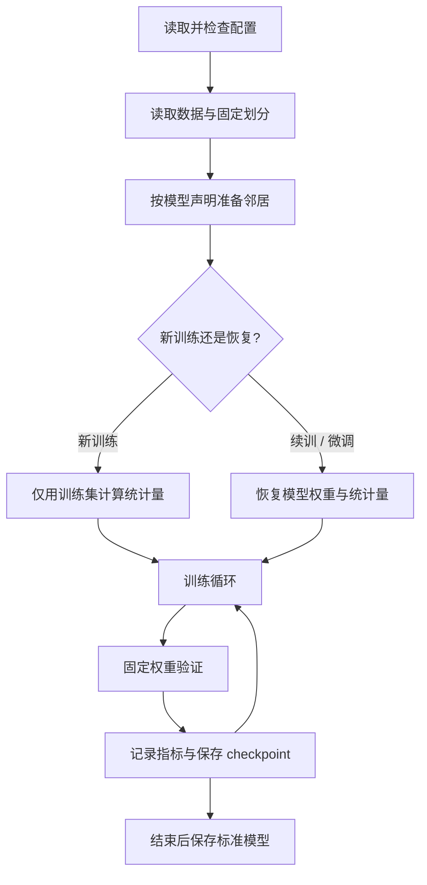

# 工作流与标准文件

## 训练配置

各模型的完整配置位于 `examples/<模型目录>/input.json`，详见[模型示例](../examples/README.md)。
已有 Cu 配置保存在 `examples/`，数据路径相对配置文件所在目录解析。
ACSF 使用 `model.descriptor.blocks[].basis[]` 逐条定义基函数，详见 [ACSF 配置与模型结构](acsf.md)。

| 配置段 | 内容 |
|---|---|
| common | 元素顺序、float32/float64、随机种子 |
| model_modules | 可选扩展模块列表；在解析模型参数前导入并完成自注册 |
| model | 模型名称、截断半径、描述子与网络超参数 |
| data | files+split 或 train_files/valid_files，以及 loader 参数 |
| training | 设备、额外训练轮数、优化器、学习率调度、梯度裁剪、`print_freq`（按 batch 计的日志间隔） |
| loss | 监督项、MSE/RMSE、起始和终止权重 |
| output | 输出目录、checkpoint 设置、model_filename |

```json
{
  "dir": "runs/example",
  "checkpoint": {"save_every": 10, "keep_best": true, "monitor": "valid_loss"},
  "model_filename": "model.pt"
}
```

这是 output 配置段，不是完整训练配置。没有 `output.export` 或 `torchscript` 开关。



能量和 virial 残差先分别除以结构原子数，再计算 MSE/RMSE；力直接按分量统计。
配置中非零权重项缺少预测或标签时明确报错。验证使用固定的终止权重，避免动态
训练权重影响跨 epoch 的 best 比较。`monitor` 当前按越小越好选择模型。
`print_freq` 的单位是 batch（优化步），不是 epoch；`1` 表示每个 batch 输出一行，
epoch 末始终输出一次汇总。控制台和 `loss.out` 的物理量误差统一为：
能量 `meV/atom`、力 `meV/Å`、virial `meV/atom`。

训练输出：

- `config.json`：本次训练配置。
- `data.json`：文件路径、内容摘要、训练与验证索引。
- `loss.out`：逐 epoch 总加权 loss、train/valid 真实 RMSE（能量 meV/atom、力 meV/Å、virial meV/atom）与耗时；新增有参考的 label 会自动追加 `T-<label>`/`V-<label>` 列。
- `loss.png`：训练结束自动生成的多面板训练曲线，同一标签的 Train/Valid 共用子图；不再需要独立 loss 绘图命令。
- `last.pt` / `epoch_XXXX.pt`：训练状态。
- `best.pt`：验证指标最佳的训练状态。
- `model.pt`：最后一轮的标准推理模型；文件名可修改。

训练集和验证集的**合计结构数小于 500,000** 时，训练结束后会使用最佳 checkpoint（best.pt）
自动完整评估真实划分，只在内存收集配对值，生成一张 `parity.png`：每标签一个子图，
Train/Valid 共轴显示。不创建 train/valid 目录，不落盘保存预测或额外指标文件。
该步骤不打乱样本、不丢弃尾批次，不重新读取原始文件或重新划分数据，绘图与最终汇总表使用同一次最佳模型评估。
合计结构数达到或超过阈值时跳过对角图，只流式计算两组指标，不收集配对数组；仍生成 loss.png 和最终汇总表，并在日志中说明。
它需要额外的一轮完整预测与绘图时间，计入最终 Total runtime。
绘图使用无窗口后端；matplotlib 已纳入基础依赖。

训练结束日志打印最佳模型在完整 Train / Valid 上的汇总表：每个标签的 RMSE 和整体相对误差。
能量使用每原子 RMSE（meV/atom），力使用分量 RMSE（meV/Å），virial 使用每原子分量 RMSE（meV/atom）；额外标签沿用各自单位。
最佳模型由 output.checkpoint.monitor 选定。若关闭 keep_best 或 best.pt 不存在，明确标记为最终模型，
不会把它称为最佳模型。model.pt 及 run() 返回值仍是最后一轮模型。

相对误差定义为 `100 * RMSE / mean(abs(reference))`，
使用整个数据集的分量求和，不逐点相除，也不对各 batch 百分比简单平均；
每原子标签的分子与分母均先按结构原子数归一化。参考值整体为零时显示 N/A。
能量百分比依赖参考能量零点，只在同一能量基准下解释，不能单独作为跨数据集的精度比较。
评估返回值中字段名为 relative_error_percent，单位为百分比，未定义时为 None。
大数据集虽然不绘图，仍需额外完整推理一遍以得到最佳模型的这张表；计入总耗时。

日志末尾的 `Runtime breakdown` 按四项打印实际耗时（秒）和占总耗时的比例：

| 阶段 | 包含内容 |
|---|---|
| Data & initialization | 配置与 checkpoint 读取、数据读取与划分、指纹校验、邻居缓存预热、模型统计量和优化器初始化 |
| Training & validation | 所有 epoch 的训练和验证，包括逐批数据准备、checkpoint 和 loss.out 写入 |
| Final evaluation | 最佳模型加载及完整 Train/Valid 指标统计、绘图配对值收集 |
| Result output | 最终模型保存、loss.png 与 parity.png 绘制、汇总表输出 |

四项计时互不重叠；前后两段结果输出会合并累计。Total 行和 Total runtime 使用同一总时长。
未缓存的逐批建邻居、数据加载与设备迁移计入训练/验证或最终评估，不是纯模型计算计时。
CUDA 仅在阶段切换时同步，不为该时间表逐 batch 额外同步。

## 续训与微调

```bash
abfml train input.json --resume runs/example/last.pt --epochs 10
abfml train input.json --fine-tune runs/example/model.pt --epochs 10
```

epochs 表示本次额外训练轮数。续训恢复优化器、调度器、步数、最佳指标及
Python/NumPy/PyTorch 随机状态；检查模型、数据、损失和优化器配置是否一致，
同时核对数据内容与划分。CPU、固定数据和相同环境下已测试续训与不中断训练一致。
不承诺不同硬件、任意自定义随机数据变换之间逐位一致。

微调只加载模型与统计量，重新开始优化器和训练计数；允许换训练数据，仍要求模型
结构与元素顺序一致。续训和微调都不重新估计原模型的归一化统计量。

## 保存和加载

```python
from abfml.serialization import load_model
from abfml.interfaces import ABFMLCalculator

model = load_model("model.pt", device="cpu")
calculator = ABFMLCalculator("best.pt", device="cpu")
```

模型文件是带版本的字典，包含模型配置、元素及精度、state_dict。训练 checkpoint
额外包含优化器、调度器、随机状态和数据划分记录。加载使用明确的文件格式标识，
不依赖猜测 TorchScript 文件，也不保存整个 Python 模型对象。

所有训练统计量作为模型状态保存。模型文件可移动，推理不需要训练数据文件；
自定义模型的 `model_modules` 也随文件保存，加载时会导入对应模块；目标环境需安装
相应扩展包。具体步骤见[新增模型与自注册](model-extension.md)。

## 独立评估

```bash
abfml evaluate model.pt test.extxyz --batch-size 8 --output evaluation
abfml evaluate best.pt test.extxyz --labels energy forces virial --output evaluation-best
```

输出 `predictions.extxyz` 与一张多标签组图 `parity.png`，没有按标签拆分的图片和 CSV。
指标通过 CLI 以表格日志打印或 Python 返回，包含 MAE、RMSE、分量数和单位，不另存 metrics.json。
能量和 virial 同时返回总量及每原子指标；力按所有分量累计，不对各 batch RMSE 简单平均。

extxyz 包含结构几何以及 `ref_*`、`pred_*` 标签，分别表示参考值和预测值。
结构量在注释行，逐原子量在原子列；`abfml_shapes` 记录形状，原子浮点列使用 17 位有效数字。
标签保持框架原始单位，virial 不除以体积、不转换为应力。

自动绘图复用本次预测，不重复推理；独立 evaluate 不受训练结束的 50 万结构阈值限制。
Python 调用 `evaluate(..., output_dir=None)` 只返回指标，不保存文件或绘图。
未标注数据仍输出包含预测的 extxyz，metrics 为空，也不画对角图。

显式 `--labels` 要求指定项均存在。每批标签需要一致，部分标注数据可先分类，
或使用 batch-size=1。当前保存能量、力、virial、原子能量、电荷、总电荷、偶极和 Born 有效电荷；
其他扩展输出需添加对应的作用域序列化。

如需自行绘图，显式导出参考值和预测值两列：

```bash
abfml plot pairs evaluation/predictions.extxyz --label forces --output forces.csv
```

详见[绘图和两列数据导出](../abfml/tools/README.md)。
